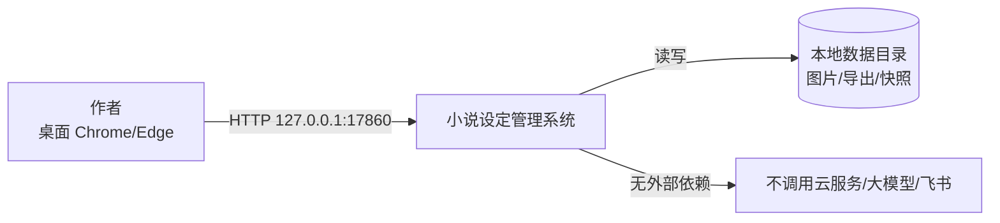
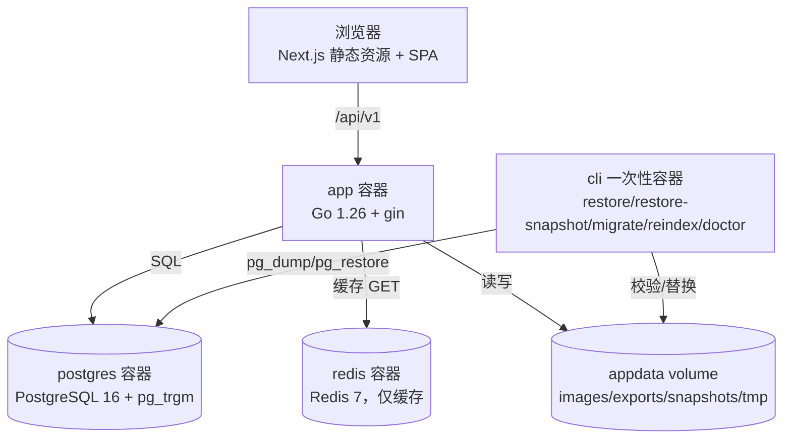
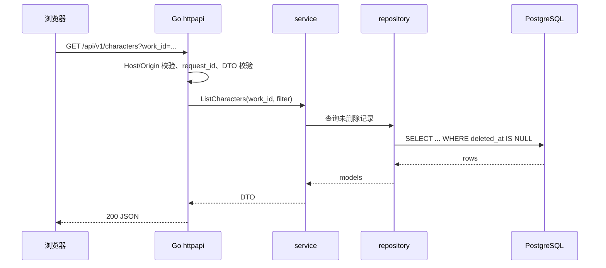
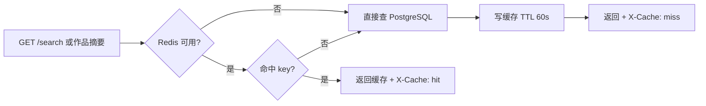
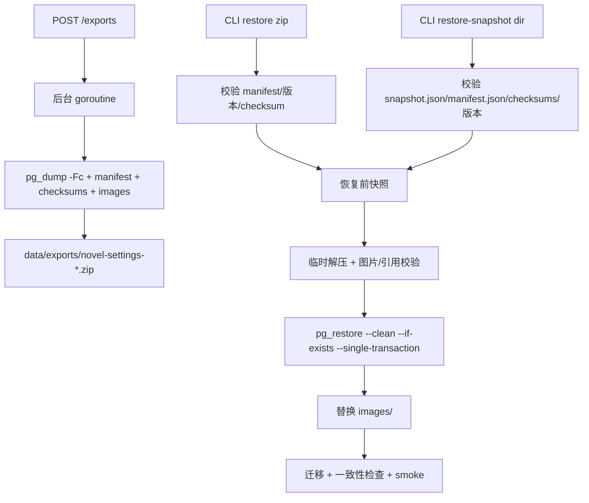

# 全局架构设计（Architecture）

| 项目 | 内容 |
|---|---|
| 文档版本 | v1.2 |
| 状态 | 已批准（P5b 复审通过；P6 同步 C-03） |
| 日期 | 2026-11-07 |
| 架构风格 | 模块化单体 + 三容器（Go 应用 / PostgreSQL / Redis 缓存） |
| 推荐技术栈 | Go 1.26 + gin + gorm + Next.js 15 + PostgreSQL 16 + Redis 7（仅缓存） |
| 上游基线 | [requirements.md](file:///d:/Project/novel-management/project/requirements.md) v1.1 Approved、[user-stories.md](file:///d:/Project/novel-management/project/user-stories.md)、[user-flow.md](file:///d:/Project/novel-management/project/user-flow.md) v1.0、[design-system.md](file:///d:/Project/novel-management/project/design-system.md) v1.0、PG-00~PG-13 |
| 约束来源 | [PROJECT-SETUP.md](file:///d:/Project/novel-management/project/PROJECT-SETUP.md)、[constitution.md](file:///d:/Project/novel-management/project/constitution.md)、[sources.md](file:///d:/Project/novel-management/project/sources.md) |
| 配套文档 | [tech-stack.md](file:///d:/Project/novel-management/project/tech-stack.md)、[data-model.md](file:///d:/Project/novel-management/project/data-model.md)、[api-contract.md](file:///d:/Project/novel-management/project/api-contract.md)、[testing-strategy.md](file:///d:/Project/novel-management/project/testing-strategy.md)、[deployment.md](file:///d:/Project/novel-management/project/deployment.md) |

> 本文中的“推荐/暂定”不等于已确认。已确认项在 §12 标注；未验证能力一律列入 §9 PoC。

---

## 1. 一致性检查

### 1.1 硬冲突

未发现需求、页面规格与技术约束之间的直接矛盾。以下为需要显式处理的缺口，均已给出处理方案并获项目发起人确认（2026-11-07），未静默修改需求文档。

| 编号 | 缺口 | 默认处理 | 状态 |
|---|---|---|---|
| C-01 | PG-10 未定义「删除含子节点的体系主节点」行为 | 默认阻止，返回 `HAS_CHILDREN`，要求先删除/移动子节点 | 已确认（2026-11-07） |
| C-02 | FR-55“恢复”是否包含回收站单项恢复 | 快照触发以 FR-55 为准：CLI 全量恢复、导入、删除作品、永久删除、清空回收站生成快照；回收站单项恢复不生成快照；手动快照仅 CLI 可选、无页面入口（P5b 修订） | 已确认（2026-11-07）；P5b 对齐 FR-55 |
| C-03 | 字段最大长度未定义 | 名称/类型/时间标签 200、简介 20,000、大事记 2,000、关系备注 500、纪元起止 100 | 已确认（2026-11-07） |
| C-04 | 作品 ≤10 是硬限制还是软上限 | 超过 10 本返回 `warnings[]`，不阻断创建 | 已确认（2026-11-07） |
| C-05 | 删除势力/地点“有下级或被引用” | 结构约束返回 `HAS_CHILDREN`，引用约束返回 `REFERENCE_CONFLICT` | 已确认（2026-11-07） |
| C-06 | 上游文档（requirements/mvp-scope/product-brief/research）仍写 V-01 为「SQLite FTS5 trigram」 | 技术栈已切换为 PostgreSQL 16；V-01 重定义为 `pg_trgm` + 短词 `ILIKE`，上游描述已同步更新 | 已确认（2026-11-07） |
| C-07 | 删除/停用前的引用检查是否包含回收站记录 | 包含回收站记录（保守），错误详情标注「回收站中」 | 已确认（2026-11-07） |

### 1.2 技术栈变更说明

项目发起人提供了个人学习路线（飞书 Wiki），要求按其中的技术栈选择。学习路线中业务后端主线为 **Go + gin + gorm**，前端为 **Next.js + Tailwind**，数据库为 **PostgreSQL**，并使用 **Redis**；Python/FastAPI 用于 RAG/Agent 项目，本项目无 AI 需求，因此不引入 Python 服务。

据此，原先基于 FastAPI + React + SQLite 的方案（v0.1）被替代：

- 后端：Go 1.26 + gin + gorm（同步请求处理 + 进程内后台任务）。
- 前端：Next.js 15（App Router，静态导出）+ React 19 + Tailwind CSS。
- 数据库：PostgreSQL 16，中文检索使用 `pg_trgm`（V-01 待验证）。
- 缓存：Redis 7，仅做缓存，不作为关键路径依赖。
- 原先的 FTS5 方案随 SQLite 一并撤销；D-02 已按 PostgreSQL 重新确认（`pg_trgm` + 短词 `ILIKE`，V-01 待执行）。

### 1.3 页面与需求一致性

- 14 份页面规格（PG-00~PG-13）与 FR-01~FR-69 均可映射到本文模块与 API（见 §10）。
- 设计系统“人物 Drawer、榜单/体系 Dialog、势力/地点内联”的交互决策不影响后端契约，仅影响前端组件分层。
- 无权限/登录页面；EX-05 记为 `N/A`。

---

## 2. 架构目标与质量属性

### 2.1 架构目标

1. **本地可运行**：Docker Desktop 一条命令起服务；无云依赖、无外部 API。
2. **数据可信**：引用不复制文本；删除/恢复不产生悬空引用；导入原子化；备份可恢复。
3. **检索达标**：1000 人物规模下 2 字/多词检索 P95 ≤150ms，结果可解释。
4. **实现可学习**：技术栈与个人学习路线一致，便于独立复现与讲解（Go 分层、PG 索引、Redis 缓存）。
5. **可演进**：模块边界清晰，未来可替换搜索、增加公网访问控制，而不重写业务。

### 2.2 质量属性场景

| 编号 | 质量属性 | 场景 | 指标 | 验证 |
|---|---|---|---|---|
| QA-01 | 性能 | 1000 人物下 2 字/空格 AND/条件检索 | P95 ≤150ms | V-01、k6 |
| QA-02 | 性能 | 1000 人物列表、人物保存 | 列表 ≤500ms；保存 ≤300ms | P-01/P-02 |
| QA-03 | 性能 | 导入 1000 人物 + 500 图片 | ≤90s，失败 0 残留 | V-02 |
| QA-04 | 性能 | 10MB 图片上传 | ≤1s（首响应） | V-05 |
| QA-05 | 性能 | 首屏可交互 | ≤2s | Playwright |
| QA-06 | 可靠性 | 导入/删除/恢复中途失败 | 单事务回滚；无半成品 | V-02/V-04 |
| QA-07 | 可靠性 | Redis 不可用 | 自动旁路，检索/保存仍可用 | V-07 |
| QA-08 | 安全 | 本地 CSRF、zip 穿越、XSS、图片伪装 | 全部拒绝或转义 | 安全测试 |
| QA-09 | 可维护 | 模块依赖方向 | `httpapi → service → domain → repository`，无反向依赖 | 架构测试 |
| QA-10 | 可恢复 | 全量导出 + 空环境恢复 | 计数/图片/引用一致 | V-03/V-04 |

---

## 3. 系统边界与上下文/容器图

### 3.1 系统上下文



- 系统边界：宿主侧仅回环可达（compose 发布 `127.0.0.1:17860`），容器内应用监听 `0.0.0.0:17860`；不监听局域网；无登录、无用户表。
- 外部依赖：无运行时外部 API；飞书只在迁移阶段作为人工整理来源，不进入运行时。

### 3.2 容器图



- `app` 容器内：Go API + 由 Go 托管的 Next.js 静态导出产物（同源，无 CORS）。
- `postgres`：唯一持久化业务数据库；不暴露宿主端口（仅内部网络）。
- `redis`：仅缓存；不持久化、不发布端口；不可用时应用旁路。
- `cli`：一次性运维容器，复用同一镜像，执行恢复/重建索引/自检。

---

## 4. 技术方案比较

### 4.1 候选方案

| 维度 | A. Go + Next.js + PostgreSQL + Redis 缓存（选用） | B. Python FastAPI + React + SQLite | C. Node/NestJS + React + PostgreSQL + Redis | D. Go + Python 双服务 + Next.js + PG + Redis |
|---|---|---|---|---|
| 与学习路线一致 | 高（Go/gin/gorm、Next.js、PG、Redis） | 中（FastAPI/React，无 Go/PG/Redis） | 中（Node 非路线主线） | 高（但 Python 无业务用途） |
| 中文检索 | `pg_trgm` + 短词 `ILIKE`，需 V-01 | FTS5 + 短词回退，需 V-01 | 同 A | 同 A |
| 部署复杂度 | 中（3 容器） | 低（单容器） | 中（3 容器） | 高（4 容器 + 双服务契约） |
| 事务/一致性 | 强（PG 单库事务） | 强（SQLite 单写者） | 强 | 跨服务一致性成本高 |
| 图片/zip 处理 | Go 标准库 + `imaging`，成熟 | Python Pillow，成熟 | Node 原生模块风险 | 同 A |
| 后台任务 | 进程内 goroutine + 状态表 | 进程内线程 + 状态表 | 进程内 + 可选 BullMQ | 跨服务任务，复杂 |
| 学习收益 | 高（分层、索引、缓存、迁移） | 中 | 中 | 高但偏离产品需求 |
| 主要代价 | 需要维护 PG/Redis 容器与迁移 | 技术栈与路线不一致 | 偏离 Go 主线 | 引入无需求的 Python 服务 |

### 4.2 选择理由

选择 **A**：

1. 与学习路线的业务后端主线一致（Go + gin + gorm + PostgreSQL + Redis），便于独立复现与面试讲解。
2. PostgreSQL 提供可靠事务、部分唯一索引、`pg_trgm` 中文子串检索，避免 SQLite 单写者与 FTS5 不确定性。
3. Redis 只做缓存，放在非关键路径；缓存失效不阻断业务，满足零成本本地运行。
4. Next.js + Tailwind 与 P3 设计系统可直接映射 CSS 变量，静态导出后由 Go 托管，避免额外 Node 运行时。
5. 不引入 Python/FastAPI：本项目没有 AI/RAG/Agent 需求，双服务只增加契约与运维成本。

### 4.3 被否方案要点

- **B**：单容器最简单，但技术栈与学习路线不一致；SQLite FTS5 中文短词需回退，且无法练习 PG 索引/事务。
- **C**：Node 全栈可行，但 Go 是学习路线主线；Node 原生图片/zip 依赖打包风险更高。
- **D**：双服务适合“Go 业务 + Python Agent”，本项目无 AI；为练习而引入 Python 会违反“不无需求引入基础设施”。

---

## 5. 模块职责、依赖方向与初始结构

### 5.1 后端模块

| 模块 | 职责 | 对外接口 | 依赖 |
|---|---|---|---|
| `httpapi` | 路由、中间件、请求校验、DTO、错误映射 | HTTP `/api/v1` | service |
| `service` | 用例编排、事务边界、引用校验、缓存失效 | Go 方法 | domain、repository、cache、search、imports、media、snapshots |
| `domain` | 纯规则：名称规范化、树、席位、引用、类别 | 纯函数/值对象 | 无 |
| `repository` | gorm 查询与持久化；不包含业务规则 | Repository 接口 | model、gorm |
| `model` | 表结构映射、索引标签、迁移实体 | struct | 无 |
| `search` | 检索文档维护、查询、排序、分页 | `SearchService` | repository、cache |
| `cache` | Redis cache-aside、epoch 失效、Noop 降级 | `Cache` 接口 | go-redis |
| `imports` | zip 安全解压、模板解析、校验、提交 | `ImportService` | domain、media、repository |
| `media` | 图片校验、重编码、缩略图、存储路径 | `MediaService` | 文件系统 |
| `snapshots` | pg_dump 快照、图片硬链接、保留 3 份 | `SnapshotService` | 文件系统、pg_dump |
| `jobs` | 进程内任务运行器 + 状态表 | `JobRunner` | repository |
| `config` / `observability` | 配置、slog、request id、健康检查 | — | — |
| `cmd/cli` | restore/restore-snapshot/migrate/reindex/doctor | CLI | service、snapshots |

依赖方向（禁止反向）：

```text
cmd/server → httpapi → service → domain
                         ├→ repository → model
                         ├→ cache
                         ├→ search
                         ├→ imports → media
                         └→ snapshots
```

- `httpapi` 不得直接调用 repository/gorm。
- `domain` 不得 import gin/gorm/redis。
- `repository` 不得包含业务判断（如“有下级则阻止”）。
- 跨模块写操作必须经 service，保证删除/恢复/引用规则统一。

### 5.2 前端模块

| 模块 | 职责 | 主要页面 |
|---|---|---|
| `app` | Next.js App Router、路由、布局 | PG-00 |
| `features/search` | 快速/条件检索、结果分组 | PG-01 |
| `features/characters` | 列表、详情、Drawer 新建、内联编辑 | PG-02/03 |
| `features/factions` | 树、详情、内联新建/编辑 | PG-04/05 |
| `features/locations` | 树、详情、关系 | PG-06/07 |
| `features/rankings` | 榜单列表、席位表、指派/换位 Dialog | PG-08/09 |
| `features/system` | 类别、节点树、排序、引用提示 | PG-10 |
| `features/imports` | 上传、校验、预览、确认、报告 | PG-11 |
| `features/trash` | 回收站、恢复、永久删除、清空 | PG-12 |
| `features/settings` | 导出、快照、版本 | PG-13 |
| `components/ui` | Button/Input/Select/Dialog/Drawer/Table/Toast 等 | 全站 |
| `lib/api` | OpenAPI 生成客户端、错误映射 | — |
| `hooks` | 查询/表单/当前作品 | — |

### 5.3 初始文件结构

```text
backend/
├─ cmd/
│  ├─ server/main.go
│  └─ cli/main.go
├─ internal/
│  ├─ config/
│  ├─ httpapi/            # router, middleware, handlers, dto
│  ├─ service/
│  ├─ domain/
│  ├─ repository/
│  ├─ model/
│  ├─ search/
│  ├─ cache/
│  ├─ imports/
│  ├─ media/
│  ├─ snapshots/
│  ├─ jobs/
│  ├─ observability/
│  └─ migrations/         # goose SQL
├─ templates/            # 导入模板 v1.0 + 示例
├─ go.mod
└─ Dockerfile

frontend/
├─ app/
│  ├─ layout.tsx
│  ├─ page.tsx            # 客户端重定向到 /search
│  ├─ search/page.tsx
│  ├─ characters/page.tsx # 列表 + 详情（详情以 ?id=<id> 选择）
│  ├─ factions/page.tsx
│  ├─ locations/page.tsx
│  ├─ rankings/page.tsx
│  ├─ system/page.tsx
│  ├─ import/page.tsx
│  ├─ trash/page.tsx
│  └─ settings/page.tsx
├─ components/ui/
├─ features/
├─ lib/api/
├─ hooks/
├─ styles/globals.css     # P3 Token → CSS 变量
├─ next.config.ts         # output: 'export'
└─ package.json

scripts/
├─ smoke.ps1
└─ fixtures/perf_seed.go
```

### 5.4 前端路由

| 路由 | 页面 | 说明 |
|---|---|---|
| `/` | 重定向 | 客户端 `router.replace('/search')` |
| `/search` | PG-01 | 唯一检索入口 |
| `/characters` | PG-02/03 | 人物列表；详情以 `/characters?id=<id>` 查询参数选择 |
| `/factions` | PG-04/05 | 势力树；详情以 `/factions?id=<id>` |
| `/locations` | PG-06/07 | 地点树；详情以 `/locations?id=<id>` |
| `/rankings` | PG-08/09 | 榜单列表；详情以 `/rankings?id=<id>` |
| `/system` | PG-10 | 体系配置 |
| `/import` | PG-11 | 导入向导 |
| `/trash` | PG-12 | 回收站 |
| `/settings` | PG-13 | 导出/快照/版本 |

- Next.js 静态导出：`output: 'export'`，无 SSR/Server Actions；所有数据经 `/api/v1`。
- **不使用动态段路由**：静态导出无法为运行时才存在的 ID 预生成页面，详情页统一采用查询参数 `?id=<id>`，不依赖 `generateStaticParams`；列表与详情共用同一 `page.tsx`，由客户端按 `id` 渲染。
- 开发环境 Next dev server 将 `/api` 代理到 Go `127.0.0.1:17860`；生产由 Go 托管 `frontend/out`。

### 5.5 状态管理与设计系统落地

- 服务端状态：TanStack Query（缓存、失效、轮询导入/导出任务）。
- 表单：React Hook Form + Zod；字段规则与 `/api/v1/meta` 常量对齐。
- 全局 UI 状态：React Context（当前作品、Toast、Dialog/Drawer 开关）；不引入 Redux/Zustand。
- 设计系统：`globals.css` 定义 P3 CSS 变量（品牌色、渐变、间距、圆角、阴影、排版）；Tailwind `@theme` 映射变量；复杂组件（席位表、树、导入步骤）用 CSS Modules；Radix UI 提供 Dialog/Drawer/Select/Tooltip 的可访问性原语；lucide-react 图标。
- 不使用 MUI/AntD/Chakra/Bootstrap；不引入第二套 Token。

---

## 6. 关键流程

### 6.1 请求生命周期



- 写请求额外：`If-Match` 版本校验 → service 事务 → 唯一/引用约束 → `cache.BumpEpoch(work_id)` → 返回。

### 6.2 Redis 缓存（cache-aside）



- Key：`nm:v1:{work_id}:epoch`、`nm:v1:{work_id}:{epoch}:search:{hash}`、`nm:v1:{work_id}:{epoch}:summary`。
- 任何写操作（创建/更新/删除/恢复/导入提交）执行 `INCR epoch`；旧 key 自然过期。
- 缓存只存检索结果与作品计数摘要，不存人物详情正文；不持久化。
- Redis 错误：记录 `WARN` 一次、旁路查询；不影响响应正确性（QA-07）。

### 6.3 检索

1. 规范化查询：NFKC、去首尾空白、连续空白折叠，按空格分词；空查询返回 `VALIDATION_ERROR`（前端显示 FR-31 提示）。
2. 每个 token 在 `search_documents` 的 name/alias/title/desc/relation 列做 `ILIKE '%token%'`；AND 组合。
3. `pg_trgm` GIN 索引加速 3 字以上；1–2 字由 1000 行级的顺序扫描承担（V-01 验证）。
4. 排序：`score DESC, updated_at DESC, id ASC`（score 权重：名称命中 4 > 别名/称号 3 > 简介 2 > 关联名 1 命中 1）；稳定排序保证分页无重复/漏项（P5b RT-11）。
5. 按实体类型分组，每组 `total` 为该组总命中，`items` 仅当前页切片；顶层返回 `total/page/page_size`；每条结果含 `matched_fields:[{field, matched_text}]` 与包含 `matched_text` 的 `snippet`（P5b RT-11）。
6. 每页 20（FR-30）；结果写 Redis 缓存。

### 6.4 删除 / 撤销 / 恢复

```mermaid
sequenceDiagram
  participant B as 浏览器
  participant G as Go
  participant S as service
  participant P as PostgreSQL
  B->>G: DELETE /characters/{id}
  G->>S: DeleteCharacter(work_id,id)
  S->>P: SELECT 引用（首领/席位）
  alt 有引用
    S-->>G: REFERENCE_CONFLICT + details
  else 无引用
    S->>P: BEGIN; UPDATE deleted_at/root; UPDATE 大事记/图片; COMMIT
    S->>S: cache.BumpEpoch
    S-->>G: undo_token + 8s
  end
```

- 分组根模型：作品/类别/人物/势力删除时，后代与大事记/图片标记同根；关系表与席位不单独标记，由父实体删除状态隐藏。
- 撤销：一次性 token，8 秒有效；恢复前重新校验名称/父级/引用。
- 回收站只列根记录；恢复整组；永久删除前快照。
- 删除/恢复被引用实体（势力、地点、榜单、体系节点等）时，同一事务内重建**所有引用方**的 `search_documents`（不只改名场景），避免回收站实体名称继续命中或恢复后缺失（P5b RT-10）。

### 6.5 导入（原子）

```mermaid
flowchart TB
  U[上传 md + zip] --> U2[空间预检：zip + 预计解压 + 1GB 快照余量]
  U2 -->|不足| E0[IMPORT_INSUFFICIENT_STORAGE，0 写入]
  U2 --> T[临时目录 tmp/imports/{id}]
  T --> V[安全解压 + 模板解析 + 校验（含类别协议）]
  V -->|错误| E[validated/failed + 错误清单，0 写入]
  V -->|0 错误| C[用户确认 commit]
  C --> S[生成快照 reason=import]
  S --> M[图片移动到 data/images/{work_id}/{import_id}/]
  M -->|失败| RB0[删除本次已移动图片 + 清理临时目录 + failed]
  M --> TX[BEGIN 单事务写入作品/类别/节点/实体/关系/席位/检索文档]
  TX -->|失败| RB[ROLLBACK + 删除本次移动图片 + 清理临时目录]
  TX -->|成功| D[completed + 报告 + 可校对实体全部 pending]
```

- 后台 goroutine 执行，状态表 `import_runs`；重启把 `running → failed`。
- **顺序以 ADR-005 为权威（P5b RT-07）**：快照 → 解压校验 → 图片移动到 `images/{work_id}/{import_id}/` → 单事务写 DB → 提交；事务失败删除本次移动的图片，成功清理临时目录。
- 导入目标为新建空作品；不做增量 upsert；重复 commit 返回同一结果。
- 临时目录 TTL 120 分钟；启动与每日清理。
- **类别初始化协议（P5b RT-08）**：导入作品以 `auto_create_builtin=false` 创建，跳过“新建作品自动生成境界”；模板必须定义类别（`体系 → 类别`），类别名必填且同作品唯一；「境界」类别名称固定、`is_builtin=1`、全作品唯一；自定义类别含境界合计 ≤10；模板缺境界时创建空的内置境界；节点按模板中类别名归属到对应类别（含内置境界）；类别不参与 review；预览/提交 `counts` 与报告包含 `system_categories`。
- **限制（P5b RT-12）**：`MAX_UPLOAD_MB=6144`；上传前预检可用空间 ≥ `zip_size + 预计解压大小 + 1GB 快照余量`；HTTP 上传/解析超时 120 分钟；超限返回 `IMPORT_INSUFFICIENT_STORAGE`，超时返回 `IMPORT_TIMEOUT`；错误码见 api-contract §1.4。

### 6.6 导出与 CLI 恢复



- `include_trash=true`：直接 `pg_dump -Fc`；`false`：复制到临时数据库、删除软删除根与隐藏关系后转储，再删除临时库（导出包真实不含回收站数据）。
- 恢复期间停止 app，避免并发写入；`pg_restore --single-transaction` 失败自动回滚，原数据与快照保留。
- 快照保留 3 份；导出默认包含回收站；两种导出包均可由同一 CLI 恢复（AC-12）。
- **快照可恢复（P5b RT-06）**：快照目录固定包含 `app.dump`、`images/`、`snapshot.json`、`manifest.json`、`checksums.sha256`；CLI `restore-snapshot <dir>` 校验 manifest/checksums/版本后恢复 DB + images，并写入 `last_restore_at`。
- **快照触发（P5b RT-17，以 requirements FR-55 为准）**：CLI 全量恢复、导入、删除作品、永久删除、清空回收站生成快照；回收站单项恢复不生成；手动快照仅 CLI 可选，无页面入口。
- **恢复命令（P5b RT-18）**：唯一入口为 `docker compose run --rm cli restore <zip>`（快照为 `docker compose run --rm cli restore-snapshot <dir>`）；`scripts/restore.sh` 不作为权威路径。

### 6.7 后台任务

- `jobs.Runner` 为进程内单 worker（导入/导出各并发 1），任务状态写 `import_runs`/`export_runs`。
- 不使用 Redis 队列/Celery/BullMQ；Redis 仅缓存（D-08）。
- 启动扫描 `running` → `failed`，前端可重试；任务结果落库。

---

## 7. 安全、配置与日志

### 7.1 安全边界

| 项 | 措施 |
|---|---|
| 网络 | 宿主仅回环可达（compose 发布 `127.0.0.1:17860`）；容器内应用必须监听 `0.0.0.0:17860`（Docker 端口转发目标为容器网络地址）；Postgres/Redis 不发布宿主端口 |
| CSRF | 校验 `Host` 白名单（由 `APP_PORT`/`ALLOWED_HOSTS` 派生，默认 `127.0.0.1:${APP_PORT}`、`localhost:${APP_PORT}`）、写请求 `Origin` 同源、`X-Requested-With` |
| CORS | 不返回 CORS 头；前后端同源 |
| CSP | `default-src 'self'; img-src 'self' data:; style-src 'self' 'unsafe-inline'; script-src 'self' 'unsafe-inline'`（本地单用户、无用户注入 HTML；P5b RT-03） |
| XSS | 前端文本插值；不使用 `dangerouslySetInnerHTML`；简介按纯文本 |
| 上传 | zip 拒绝 `..`/绝对路径/符号链接/超限；图片校验 MIME+魔数，≤10MB，重编码 |
| 日志 | 不记录正文、完整路径、堆栈；只记录 request_id/实体 ID/错误码/耗时 |
| 依赖 | `govulncheck` + `npm audit`；禁止 GPL/AGPL |
| 未来公网 | 必须新增 Nginx/HTTPS + 访问控制（本版不实现） |

### 7.2 配置

| 变量 | 默认 | 说明 |
|---|---|---|
| `APP_HOST` | `0.0.0.0`（容器内） | 绑定地址；容器内必须监听 `0.0.0.0`，宿主仅经 compose 的 `127.0.0.1:17860:17860` 可达 |
| `APP_PORT` | `17860` | 端口；Host/Origin 白名单由此派生 |
| `ALLOWED_HOSTS` | `127.0.0.1:${APP_PORT},localhost:${APP_PORT}` | Host 白名单（逗号分隔）；改端口无需改白名单 |
| `DATA_DIR` | `/data` | 图片/导出/快照/临时 |
| `DATABASE_URL` | `postgres://app:***@db:5432/novel?sslmode=disable` | PG 连接 |
| `REDIS_ADDR` | `cache:6379` | Redis 地址 |
| `REDIS_PASSWORD` | 空（本地可设） | 内部网络密码 |
| `CACHE_TTL_SEC` | `60` | 缓存 TTL |
| `MAX_UPLOAD_MB` | `6144` | 导入 zip 上限 |
| `IMPORT_TIMEOUT_MIN` | `120` | 导入上传/解析 HTTP 超时（分钟） |
| `SNAPSHOT_KEEP` | `3` | 快照保留 |
| `IMPORT_TTL_MIN` | `120` | 临时目录 TTL |
| `LOG_LEVEL` | `INFO` | 日志级别 |

- 密钥：仅 PG/Redis 密码；放 `.env` 或 Compose secret，不提交仓库；无云服务密钥。
- 日志：slog JSON → stdout + `data/logs/app.log` 滚动。

### 7.3 可观测性

- `/api/v1/health` 返回 `db`、`cache` 状态；Redis 故障为 `degraded`，不阻断。
- 请求日志：`request_id, method, path, status, duration_ms`；不记录 body。
- 导入/导出状态与耗时在任务表与设置页可见。

---

## 8. AI / Agent 设计

**不适用。** 本项目明确不调用大模型、不做语义检索/生成、不做 Agent 工具调用、无模型上下文/记忆/追踪/成本设计（requirements §0.3、§2.3）。学习路线中的 LangGraph/RAG 能力不在本产品范围内。

---

## 9. 风险与 PoC

| 编号 | 风险 | 影响 | 应对/PoC |
|---|---|---|---|
| R-01 | pg_trgm 对 1–2 字中文查询退化 | 检索 P95 超标 | V-01；短词走 `ILIKE`；必要时增加 `pg_bigm`/`zhparser` 或应用层前缀索引 |
| R-02 | 3 容器增加本地运维成本 | 启动失败/端口冲突 | Compose healthcheck + 文档；`depends_on: condition: service_healthy` |
| R-03 | Redis 缓存与数据不一致 | 读到旧检索结果 | epoch 失效 + TTL 60s；只缓存可重建数据 |
| R-04 | 1000 人物导入超 90s | 验收失败 | V-02；批量 insert + 单事务 + 关闭逐行日志 |
| R-05 | zip 路径穿越/压缩炸弹 | 本地文件泄露/磁盘耗尽 | 安全解压 + 条目/大小上限；恶意 fixture |
| R-06 | 5GB 导出/恢复在 Windows volume 上失败 | 数据不可恢复 | V-03/V-04；临时目录 + 校验 + 快照 |
| R-07 | Next.js 静态导出限制 | 无法使用 SSR/服务端能力 | 只做客户端 SPA；数据全走 API |
| R-08 | gorm N+1 / 全表扫描 | 列表/详情慢 | 预加载、索引、EXPLAIN 检查；P-01 |
| R-09 | Redis 单点故障 | 缓存失效 | 旁路降级；不持久化；V-07 |
| R-10 | 学习路线技术面过宽 | 实现拖延 | 锁定本版栈；不引入 Python/AI/消息队列 |

### 9.1 PoC 清单

| 编号 | 验证内容 | 通过标准 | 阻断 |
|---|---|---|---|
| V-01 | PostgreSQL 中文检索 | 1000 人物；2 字/3 字/空格 AND/条件；30 条查询集正确；冷/热缓存 P95 ≤150ms | 搜索实现冻结 |
| V-02 | 导入原子性与性能 | 1000 人物 + 500 图片 ≤90s；失败 0 残留 | 导入实现冻结 |
| V-03 | 导出/快照 | 5GB 数据可导出；checksum 通过；保留 3 份 | 导出实现冻结 |
| V-04 | CLI 恢复 | 空环境恢复计数/图片/引用一致；失败可回退 | 恢复流程冻结 |
| V-05 | 图片上传 | 10MB ≤1s 首响应；缩略图成功 | 媒体实现冻结 |
| V-06 | 模板错误定位 | 错误全部进入清单、0 写入 | 模板冻结 |
| V-07 | Redis 故障降级 | 停 Redis 后检索/保存仍可用，`health=degraded` | 缓存策略冻结 |

> PoC 未通过前，不得把对应能力写成“已实现”或“已达标”。

---

## 10. 追溯矩阵

| Requirement | Page Spec | 模块 | API | 表 | 验收 |
|---|---|---|---|---|---|
| FR-01~03 | PG-00、PG-13 | works、settings | `/works`、`/settings` | works、system_categories | AC-01、AC-13 |
| FR-04~08 | PG-02、PG-03 | characters、media、chronicles | `/characters`、`/media`、`/chronicles` | characters、character_names、media_assets | AC-02、AC-03、AC-14、AC-33 |
| FR-09~12 | PG-04、PG-05 | factions、chronicles | `/factions` | factions | AC-04、AC-14 |
| FR-13~16 | PG-06、PG-07 | locations | `/locations` | locations、character_locations、location_factions | AC-05、AC-14 |
| FR-17~20 | PG-08、PG-09 | rankings | `/rankings` | rankings、ranking_seats | AC-06 |
| FR-21~26 | PG-10 | system | `/system-categories`、`/system-nodes` | system_categories、system_nodes、character_system_refs | AC-07、AC-13、AC-14 |
| FR-27~33 | PG-01 | search、cache | `/search` | search_documents + pg_trgm | AC-08、AC-23 |
| FR-34~38 | PG-03/05/07/09/10 | references、service | 各详情端点 | 全部引用列/关系表 | AC-09、AC-14 |
| FR-39~46 | PG-11 | imports | `/imports` | import_runs | AC-10、AC-11、AC-18~AC-21、V-02 |
| FR-47~51 | PG-02/03/05/07/09/10 | domain | 各写端点 | 约束/索引 | AC-11、AC-14、AC-17 |
| FR-52~56 | PG-13 | exports、snapshots、cli | `/exports`、`/snapshots` | export_runs、snapshots | AC-12、AC-22 |
| FR-57~63 | PG-12 | trash | `/trash` | 各表 `deleted_at`/`deleted_root_id` | AC-13、AC-14 |
| FR-64~69 | PG-00~PG-13 | frontend | — | — | AC-15、AC-27、AC-28 |
| NFR 性能 | — | search、cache、service | — | 索引 | AC-23、AC-24、AC-32、AC-33、V-01~V-05 |
| NFR 安全 | — | httpapi、imports、media | — | — | AC-29、AC-30 |

---

## 11. 部署与测试概要

- 部署：`app`（Go + Next 静态）+ `db`（PostgreSQL 16）+ `cache`（Redis 7）；Compose 一键起；数据卷 `pgdata` + `appdata`；详见 [deployment.md](file:///d:/Project/novel-management/project/deployment.md)。
- 测试：Go 单元（domain/service）+ 集成（testcontainers Postgres/Redis）+ API `httptest` + Next 组件（Vitest）+ E2E（Playwright）+ 性能（k6）；详见 [testing-strategy.md](file:///d:/Project/novel-management/project/testing-strategy.md)。
- CI：`go test ./...`、`golangci-lint`、`govulncheck`、`npm run lint/typecheck/test/build`、迁移检查、OpenAPI 快照、E2E smoke。

---

## 12. 决策状态

| 编号 | 决策 | 状态 | 说明 |
|---|---|---|---|
| D-01 | Go + gin/gorm + Next.js + PostgreSQL + Redis 缓存 | **已确认（2026-11-07）** | 按学习路线选择；见 ADR-001/002 |
| D-02 | PostgreSQL `pg_trgm` + 短词 `ILIKE` 回退 | **已确认（2026-11-07）**；V-01 待执行 | 原 FTS5 方案随 SQLite 撤销；实现细节以 ADR-003 为准 |
| D-03 | 软删除分组根模型（无回收站表） | **已确认（2026-11-07）** | ADR-004 |
| D-04 | 导入临时目录 + 单事务 + 后台任务 | **已确认（2026-11-07）** | ADR-005 |
| D-05 | CLI 全量恢复 | **已确认（2026-11-07）**；P5b 补充 `restore-snapshot` | ADR-006；恢复命令见 §6.6 |
| D-06 | 删除含子节点的体系主节点：阻止 | **已确认（2026-11-07）** | C-01 |
| D-07 | 快照触发：CLI 全量恢复、导入、删除作品、永久删除、清空回收站；回收站单项恢复不生成；手动快照仅 CLI | **已确认（2026-11-07）**；P5b 对齐 FR-55 | C-02 |
| D-08 | Redis 仅做缓存，不做队列/关键依赖 | **已确认（2026-11-07）** | ADR-007 |
| D-09 | Next.js 静态导出，由 Go 托管；详情页使用查询参数路由（`?id=<id>`），不使用动态段/`generateStaticParams` | **已确认（2026-11-07）**；P5b 修订路由 | 见 TS-Q；RT-01 |
| C-07 | 引用检查包含回收站记录（保守） | **已确认（2026-11-07）** | 避免隐藏引用导致永久删除失败；见 data-model §5 |

> 未确认项不得写成既定事实；实现阶段不得擅自改变已确认决策。

---

## 13. ADR 索引

| ADR | 决策 | 状态 |
|---|---|---|
| [ADR-001](file:///d:/Project/novel-management/project/adr/ADR-001-modular-monolith.md) | 模块化单体 + 三容器部署 | Accepted |
| [ADR-002](file:///d:/Project/novel-management/project/adr/ADR-002-stack-go-next-postgres.md) | Go + Next.js + PostgreSQL + Redis 技术栈 | Accepted |
| [ADR-003](file:///d:/Project/novel-management/project/adr/ADR-003-chinese-search.md) | PostgreSQL 中文检索与回退 | Accepted（V-01 待执行） |
| [ADR-004](file:///d:/Project/novel-management/project/adr/ADR-004-soft-delete-root.md) | 软删除分组根模型 | Accepted |
| [ADR-005](file:///d:/Project/novel-management/project/adr/ADR-005-atomic-import.md) | 导入原子性与临时目录 | Rev.2（P5b，待复审） |
| [ADR-006](file:///d:/Project/novel-management/project/adr/ADR-006-export-restore-cli.md) | 导出包与 CLI 恢复（含快照恢复） | Rev.2（P5b，待复审） |
| [ADR-007](file:///d:/Project/novel-management/project/adr/ADR-007-redis-cache.md) | Redis 仅缓存与非关键路径 | Accepted |

> ADR-002 原文件名 `stack-fastapi-react-sqlite.md` 已删除，避免与新栈混淆；如需旧链接兼容，请在版本控制中保留历史记录，不在仓库内维护旧文件。

---

## 14. 变更记录

| 日期 | 版本 | Finding ID | 决策 | 原因/变更摘要 |
|---|---|---|---|---|
| 2026-11-07 | v1.1 | RT-01 | 详情页改查询参数路由 `/characters?id=<id>`、`/factions?id=<id>`、`/locations?id=<id>`、`/rankings?id=<id>`；保留 `output:'export'`，删除 `[id]` 动态段与 `generateStaticParams` 依赖 | 静态导出无法在构建期枚举运行时 ID，原动态段路由导致 `next build` 失败/详情 404 |
| 2026-11-07 | v1.1 | RT-02 | 容器内 `APP_HOST=0.0.0.0`、`APP_PORT=17860`；宿主仅经 compose `127.0.0.1:17860:17860` 回环可达 | Docker 端口转发目标是容器网络地址，容器内监听 loopback 会导致宿主不可达 |
| 2026-11-07 | v1.1 | RT-03 | CSP `script-src 'self' 'unsafe-inline'` | Next.js 静态导出含内联引导脚本；本地单用户、无用户 HTML，增加 E2E 覆盖 |
| 2026-11-07 | v1.1 | RT-06 | 快照目录固定结构 + CLI `restore-snapshot <dir>` | 原快照无恢复入口，FR-55“可恢复”无法验收 |
| 2026-11-07 | v1.1 | RT-07 | 导入顺序统一为 ADR-005：快照 → 解压校验 → 移图 → 单事务写 DB；TX 失败删除本次移动图片 | 消除 architecture 与 ADR-005 顺序冲突，避免 commit 后移图失败产生缺图 |
| 2026-11-07 | v1.1 | RT-08 | 导入类别初始化协议：`auto_create_builtin=false`、模板定义类别、境界唯一/固定名/is_builtin=1、合计 ≤10、节点按类别名归属、类别不参与 review | 防止重复创建境界、类别未定义或节点挂错类别 |
| 2026-11-07 | v1.1 | RT-10 | 删除/恢复被引用实体时同事务重建所有引用方 `search_documents` | 原规则仅覆盖改名，回收站实体名称仍可被检索命中 |
| 2026-11-07 | v1.1 | RT-11 | 检索排序 `score DESC, updated_at DESC, id ASC`；分组 total 与当前页切片语义、`matched_fields` | 保证分页稳定与结果可解释 |
| 2026-11-07 | v1.1 | RT-17 | 快照触发对齐 requirements FR-55；回收站单项恢复不生成；手动快照仅 CLI | 修正 D-07/C-02 字面“仅 CLI 全量恢复生成快照” |
| 2026-11-07 | v1.1 | RT-22/23 | CLI migrate 获取同一 advisory lock；Host 白名单由 `APP_PORT`/`ALLOWED_HOSTS` 派生 | 避免迁移与在线写入并发；改端口不再 403 |
| 2026-11-07 | v1.2（P6） | C-03 | 修正 §10 追溯矩阵验收列错位（FR-09~12→AC-04、FR-13~16→AC-05、FR-17~20→AC-06、FR-21~26→AC-07、FR-39~46→AC-10/11、FR-52~56→AC-12/22、FR-57~63→AC-13/14、FR-64~69→AC-27/28） | 原矩阵验收 ID 整体错位，无法作为 P6 追踪基线 |
