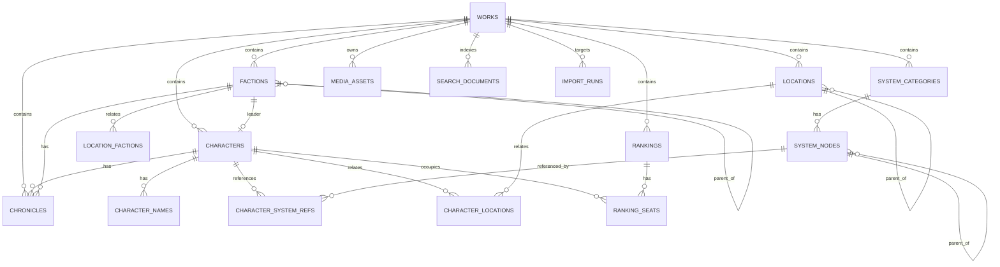

# 数据模型（Data Model）

| 项目 | 内容 |
|---|---|
| 文档版本 | v1.3 |
| 状态 | 修订（F10 回写 CHG-005，2026-11-13） |
| 日期 | 2026-11-13 |
| 数据库 | PostgreSQL 16（UTF-8；`pg_trgm` 扩展；`timezone=UTC`） |
| ORM / 迁移 | gorm v1.25+（postgres driver）+ goose v3（嵌入式 SQL 迁移） |
| 上游 | [requirements.md](file:///d:/Project/novel-management/project/requirements.md) §6、[architecture.md](file:///d:/Project/novel-management/project/architecture.md)、[tech-stack.md](file:///d:/Project/novel-management/project/tech-stack.md) |
| 相关 ADR | [ADR-003 中文检索](file:///d:/Project/novel-management/project/adr/ADR-003-chinese-search.md)、[ADR-004 软删除根模型](file:///d:/Project/novel-management/project/adr/ADR-004-soft-delete-root.md)、[ADR-007 Redis 缓存](file:///d:/Project/novel-management/project/adr/ADR-007-redis-cache.md) |

> 本文件只定义持久化结构、约束、迁移与备份。字段级 HTTP 契约见 [api-contract.md](file:///d:/Project/novel-management/project/api-contract.md)。
> Redis 不承载持久化数据；缓存键与失效规则见 architecture.md §6.2。

---

## 1. ER Diagram



> 图中略去 `media_assets` 主图唯一关系、`app_settings`、`snapshots`、`export_runs`（全局或非关系型表）。

---

## 2. 设计原则

1. **作品是唯一数据边界**：除 `works`、`snapshots`、`export_runs`、`app_settings` 外，所有业务表都含 `work_id`。
2. **不建用户表、角色表、审计表、回收站表**（requirements §6.1）。
3. **删除标记统一**：`deleted_at` + `deleted_root_id` + `deleted_by_action`，见 ADR-004；关系表与席位不单独标记。
4. **不复制实体文本**：关系表只存 ID 与备注；展示名通过 join 读取（FR-34）。
5. **名称规范化**：所有可唯一名称额外存 `name_key`（NFKC → casefold → trim → 连续空白折叠为单空格）；唯一索引基于 `name_key`，英文不区分大小写（FR-48）。
6. **ID 为 26 位 ULID 文本**：可排序、无自增依赖、便于导出与合并；应用层生成，数据库不依赖序列。
7. **时间统一 `TIMESTAMPTZ`**：写入 UTC；展示按 `Asia/Shanghai`；API 输出 ISO-8601 UTC。
8. **乐观锁**：所有可编辑实体含 `version INTEGER NOT NULL DEFAULT 1`，每次更新 `version = version + 1`；请求携带 `If-Match`。
9. **树约束在服务层强制**：体系节点最多两级；势力/地点深度不限但禁止环。
10. **数据库约束优先**：能由部分唯一索引、CHECK、FK 表达的规则必须落到数据库；跨作品与树环等复杂规则由 service 校验并在集成测试覆盖。
11. **Redis 不是数据源**：任何表都不依赖缓存一致性；缓存丢失不改变数据库事实。

---

## 3. Entity Definitions

### 3.1 works（作品）

| Field | Type | Nullable | Default | Constraint | Description |
|---|---|---|---|---|---|
| id | TEXT(26) | No | — | PK | ULID |
| name | TEXT | No | — | 1–200 字符 | 作品名称 |
| name_key | TEXT | No | — | 部分唯一 `works_name_key_uq` | 规范化名称 |
| description | TEXT | Yes | NULL | ≤20,000 | 简介 |
| created_at | TIMESTAMPTZ | No | `now()` | — | UTC |
| updated_at | TIMESTAMPTZ | No | `now()` | — | UTC |
| version | INTEGER | No | 1 | ≥1 | 乐观锁 |
| deleted_at | TIMESTAMPTZ | Yes | NULL | — | 软删除时间 |
| deleted_root_id | TEXT(26) | Yes | NULL | CHECK 与 `deleted_at` 同步 | 删除根（作品自身） |
| deleted_by_action | TEXT | Yes | NULL | `work_delete` | 删除动作 |

### 3.2 characters（人物）

| Field | Type | Nullable | Default | Constraint | Description |
|---|---|---|---|---|---|
| id | TEXT(26) | No | — | PK | ULID |
| work_id | TEXT(26) | No | — | FK → works.id `ON DELETE CASCADE`；索引 | 所属作品 |
| name | TEXT | No | — | 1–200 | 主名称 |
| name_key | TEXT | No | — | 部分唯一 `(work_id, name_key)` | 规范化名称 |
| description | TEXT | Yes | NULL | ≤20,000 | 简介；纯文本 |
| faction_id | TEXT(26) | Yes | NULL | FK → factions.id `ON DELETE RESTRICT`（`characters_faction_fk`）；部分索引 `(work_id, faction_id) WHERE deleted_at IS NULL` | 所属势力/分支 0..1 |
| review_status | TEXT | No | `reviewed` | `reviewed` / `pending`（API 映射 `confirmed`/`pending`） | 导入后为 pending |
| reviewed_at | TIMESTAMPTZ | Yes | NULL | — | 校对确认时间（P5b RT-04） |
| reviewed_by | TEXT | Yes | NULL | 无默认值（P5b 曾计划默认 `local-author`，实现未落）；本版无用户表 | 校对者 |
| created_at / updated_at | TIMESTAMPTZ | No | `now()` | — | — |
| version | INTEGER | No | 1 | ≥1 | 乐观锁 |
| deleted_at / deleted_root_id / deleted_by_action | TIMESTAMPTZ / TEXT / TEXT | Yes | NULL | CHECK 同步 | 软删除 |

> 实现（`0004_characters.sql`）曾在 0004 中含 `image_path` 内部占位列；`0005_characters_media_chronicles.sql` 已删除该列，改由 `media_assets` 承载主图，Down 时恢复该列。
> `work_id` 使用 `ON DELETE CASCADE`（与父作品物理删除一致），而非早期设计的 `RESTRICT`；软删除仍由 `deleted_root_id` 控制。

### 3.3 character_names（别名 / 称号）

| Field | Type | Nullable | Default | Constraint | Description |
|---|---|---|---|---|---|
| id | TEXT(26) | No | — | PK | ULID |
| character_id | TEXT(26) | No | — | FK → characters.id `ON DELETE CASCADE` | 随人物物理删除 |
| work_id | TEXT(26) | No | — | 冗余，用于检索与隔离 | — |
| kind | TEXT | No | — | CHECK `alias` / `title` | 别名或称号 |
| value | TEXT | No | — | 1–100 | 原文（实现上限 100，非 200） |
| value_key | TEXT | No | — | 唯一 `(character_id, kind, value_key)` | 同一人物内去重 |
| sort_order | INTEGER | No | 0 | — | 展示顺序 |

> 别名/称号允许与其他人物重复（FR-08），只保证同一人物内去重。
> 关系表不加 `deleted_*`：人物软删除时由人物状态隐式隐藏；物理级联随人物删除。

### 3.4 factions（势力树）

| Field | Type | Nullable | Default | Constraint | Description |
|---|---|---|---|---|---|
| id | TEXT(26) | No | — | PK | — |
| work_id | TEXT(26) | No | — | FK → works.id `ON DELETE CASCADE`；索引 | — |
| name | TEXT | No | — | CHECK 1–200 | 名称 |
| name_key | TEXT | No | — | 部分唯一 `(work_id, name_key)` | 规范化 `lower(trim(name))` |
| parent_id | TEXT(26) | Yes | NULL | FK → factions.id `ON DELETE RESTRICT`；同作品；禁止环 | 上级 0..1 |
| leader_character_id | TEXT(26) | Yes | NULL | FK → characters.id `ON DELETE RESTRICT`；同作品 | 首领 0..1 |
| description | TEXT | Yes | NULL | CHECK ≤20,000 | 简介 |
| review_status | TEXT | No | `reviewed` | CHECK `reviewed`/`pending` | 校对状态（API 映射 `confirmed`/`pending`） |
| reviewed_at | TIMESTAMPTZ | Yes | NULL | — | 校对确认时间 |
| reviewed_by | TEXT | Yes | NULL | 无默认值 | 校对者（本版无用户表） |
| version | INTEGER | No | 1 | CHECK ≥1 | 乐观锁 |
| created_at / updated_at | TIMESTAMPTZ | No | `now()` | — | — |
| deleted_at / deleted_root_id / deleted_by_action | TIMESTAMPTZ / TEXT / TEXT | Yes | NULL | CHECK 同步 | 软删除三件套 |

> `0006_factions_chronicles.sql` 新建；名称长度/简介长度/软删除一致性均有命名 CHECK（`factions_name_len`、`factions_desc_len`、`factions_deleted_consistent`）。

### 3.5 locations（地点树）

| Field | Type | Nullable | Default | Constraint | Description |
|---|---|---|---|---|---|
| id | TEXT(26) | No | — | PK | — |
| work_id | TEXT(26) | No | — | FK → works.id；索引 | — |
| name | TEXT | No | — | 1–200 | 名称 |
| name_key | TEXT | No | — | 部分唯一 `(work_id, name_key)` | 规范化 |
| parent_id | TEXT(26) | Yes | NULL | FK → locations.id `ON DELETE RESTRICT`；禁止环 | 上级 0..1 |
| type_text | TEXT | Yes | NULL | ≤200 | 自由文本类型（星域/星城/秘境…） |
| description | TEXT | Yes | NULL | ≤20,000 | 简介 |
| review_status | TEXT | No | `reviewed` | — | — |
| reviewed_at | TIMESTAMPTZ | Yes | NULL | — | 校对确认时间（P5b RT-04） |
| reviewed_by | TEXT | Yes | NULL | 默认 `local-author` | 校对者（P5b RT-04） |
| created_at / updated_at / version | — | — | — | — | — |
| deleted_at / deleted_root_id / deleted_by_action | — | Yes | NULL | — | 软删除 |

### 3.6 rankings（榜单）

| Field | Type | Nullable | Default | Constraint | Description |
|---|---|---|---|---|---|
| id | TEXT(26) | No | — | PK | — |
| work_id | TEXT(26) | No | — | FK → works.id | — |
| name | TEXT | No | — | 1–200 | 名称 |
| name_key | TEXT | No | — | 部分唯一 `(work_id, name_key)` | — |
| seat_count | INTEGER | No | 100 | CHECK `1..200` | 席位数 |
| review_status | TEXT | No | `reviewed` | — | — |
| reviewed_at | TIMESTAMPTZ | Yes | NULL | — | 校对确认时间（P5b RT-04） |
| reviewed_by | TEXT | Yes | NULL | 默认 `local-author` | 校对者（P5b RT-04） |
| created_at / updated_at / version | — | — | — | — | — |
| deleted_at / deleted_root_id / deleted_by_action | — | Yes | NULL | — | 软删除 |

### 3.7 ranking_seats（席位）

| Field | Type | Nullable | Default | Constraint | Description |
|---|---|---|---|---|---|
| id | TEXT(26) | No | — | PK | ULID |
| work_id | TEXT(26) | No | — | 冗余隔离 | — |
| ranking_id | TEXT(26) | No | — | FK → rankings.id `ON DELETE CASCADE` | — |
| seat_no | INTEGER | No | — | CHECK `1..200`；唯一 `(ranking_id, seat_no)` | 席位号即名次 |
| character_id | TEXT(26) | Yes | NULL | FK → characters.id `ON DELETE RESTRICT`；部分唯一 `(ranking_id, character_id)` | 0..1 人物 |
| note | TEXT | Yes | NULL | ≤500 | 备注，可写「并列」 |
| version | INTEGER | No | 1 | ≥1 | 席位乐观锁 |
| created_at / updated_at | TIMESTAMPTZ | No | `now()` | — | — |

> 席位行在创建榜单时按 1..N 批量生成；扩容追加行；缩容仅删除尾部 `character_id IS NULL` 的行。席位不单独软删除：随榜单软删除而隐藏，恢复榜单时原样返回。

### 3.8 system_categories（体系类别）

| Field | Type | Nullable | Default | Constraint | Description |
|---|---|---|---|---|---|
| id | TEXT(26) | No | — | PK | — |
| work_id | TEXT(26) | No | — | FK → works.id | — |
| name | TEXT | No | — | 1–200 | 类别名 |
| name_key | TEXT | No | — | 部分唯一 `(work_id, name_key)` | 规范化 |
| category_type | TEXT | No | `normal` | CHECK `normal` / `era`；创建后不可改 | — |
| is_enabled | BOOLEAN | No | `true` | — | 停用后人物不可选 |
| is_builtin | BOOLEAN | No | `false` | — | 内置「境界」= true |
| sort_order | INTEGER | No | 0 | — | 类别展示顺序 |
| created_at / updated_at / version | — | — | — | — | — |
| deleted_at / deleted_root_id / deleted_by_action | — | Yes | NULL | — | 软删除（整组） |

约束：每作品最多 10 类（含境界），由服务层校验并返回 `CATEGORY_LIMIT`；内置类别名必须为「境界」，服务层禁止改名/停用/删除。`system_categories` 另加部分唯一索引保证每作品恰有一个 `is_builtin=true`（未删除时）。

### 3.9 system_nodes（体系节点）

| Field | Type | Nullable | Default | Constraint | Description |
|---|---|---|---|---|---|
| id | TEXT(26) | No | — | PK | — |
| work_id | TEXT(26) | No | — | FK → works.id | — |
| category_id | TEXT(26) | No | — | FK → system_categories.id `ON DELETE RESTRICT` | 所属类别 |
| parent_id | TEXT(26) | Yes | NULL | FK → system_nodes.id `ON DELETE RESTRICT`；同类别；最多两级 | 父级 0..1 |
| name | TEXT | No | — | 1–200 | 节点名 |
| name_key | TEXT | No | — | 部分唯一 `(category_id, COALESCE(parent_id,''), name_key)` | 同父唯一 |
| sort_order | INTEGER | No | 0 | — | 同级排序 |
| era_start_text | TEXT | Yes | NULL | ≤100 | 仅 era 类别 |
| era_end_text | TEXT | Yes | NULL | ≤100 | 仅 era 类别 |
| review_status | TEXT | No | `reviewed` | — | — |
| reviewed_at | TIMESTAMPTZ | Yes | NULL | — | 校对确认时间（P5b RT-04） |
| reviewed_by | TEXT | Yes | NULL | 默认 `local-author` | 校对者（P5b RT-04） |
| created_at / updated_at / version | — | — | — | — | — |
| deleted_at / deleted_root_id / deleted_by_action | — | Yes | NULL | — | 软删除 |

约束：`parent_id` 指向的节点必须 `parent_id IS NULL`（两级上限）；`category_type='era'` 才允许起止文本；主节点含子节点时的删除默认阻止（C-01）。

### 3.10 character_system_refs（人物体系引用）

| Field | Type | Nullable | Default | Constraint | Description |
|---|---|---|---|---|---|
| id | TEXT(26) | No | — | PK | — |
| work_id | TEXT(26) | No | — | 冗余隔离 | — |
| character_id | TEXT(26) | No | — | FK → characters.id `ON DELETE CASCADE` | — |
| category_id | TEXT(26) | No | — | FK → system_categories.id `ON DELETE RESTRICT` | 类别 |
| node_id | TEXT(26) | No | — | FK → system_nodes.id `ON DELETE RESTRICT`；必须同类别 | 节点 |
| created_at / updated_at | TIMESTAMPTZ | No | `now()` | — | — |

唯一：`(character_id, category_id)` —— 每类别 0..1，天然满足 FR-23。

### 3.11 character_locations（人物-地点）

| Field | Type | Nullable | Default | Constraint | Description |
|---|---|---|---|---|---|
| id | TEXT(26) | No | — | PK | — |
| work_id | TEXT(26) | No | — | 冗余隔离 | — |
| character_id | TEXT(26) | No | — | FK → characters.id `ON DELETE CASCADE` | — |
| location_id | TEXT(26) | No | — | FK → locations.id `ON DELETE RESTRICT` | — |
| note | TEXT | Yes | NULL | ≤500 | 备注 |
| created_at / updated_at | TIMESTAMPTZ | No | `now()` | — | — |

唯一：`(character_id, location_id)`。

### 3.12 location_factions（地点-势力）

| Field | Type | Nullable | Default | Constraint | Description |
|---|---|---|---|---|---|
| id | TEXT(26) | No | — | PK | — |
| work_id | TEXT(26) | No | — | 冗余隔离 | — |
| location_id | TEXT(26) | No | — | FK → locations.id `ON DELETE CASCADE` | — |
| faction_id | TEXT(26) | No | — | FK → factions.id `ON DELETE RESTRICT` | — |
| note | TEXT | Yes | NULL | ≤500 | 备注 |
| created_at / updated_at | TIMESTAMPTZ | No | `now()` | — | — |

唯一：`(location_id, faction_id)`。

### 3.13 chronicles（大事记）

| Field | Type | Nullable | Default | Constraint | Description |
|---|---|---|---|---|---|
| id | TEXT(26) | No | — | PK | — |
| work_id | TEXT(26) | No | — | FK → works.id | — |
| owner_type | TEXT | No | — | CHECK `character` / `faction` | 归属实体类型 |
| owner_id | TEXT(26) | No | — | 多态引用（应用层校验） | 归属实体 |
| text | TEXT | No | — | 1–2000 | 正文 |
| time_label | TEXT | Yes | NULL | ≤200 | 自由文本时间标签 |
| sort_order | INTEGER | No | 0 | — | 手工顺序 |
| version | INTEGER | No | 1 | ≥1 | 乐观锁（`If-Match`） |
| created_at / updated_at | TIMESTAMPTZ | No | `now()` | — | — |
| deleted_at / deleted_root_id / deleted_by_action | — | Yes | NULL | — | 随实体同根软删除 |

> 人物与势力均支持大事记（CHG-006 放宽 CHECK）；地点大事记仍不做（FR-16 未要求）。多态引用无法用 FK，删除/恢复由 service 维护。
> 单条删除使用 `undo_tokens.root_type='chronicle'` 的 8 秒撤销，不进入回收站列表、不产生快照。

### 3.14 media_assets（图片资产）

| Field | Type | Nullable | Default | Constraint | Description |
|---|---|---|---|---|---|
| id | TEXT(26) | No | — | PK | — |
| work_id | TEXT(26) | No | — | FK → works.id | — |
| entity_type | TEXT | No | — | CHECK 本期固定 `character` | 归属类型 |
| entity_id | TEXT(26) | No | — | 应用层校验 | 人物 ID |
| original_path | TEXT | No | — | 相对 `DATA_DIR`，禁止绝对路径与 `..` | 原图 |
| thumb_path | TEXT | Yes | NULL | 相对路径 | 缩略图 |
| mime | TEXT | No | — | CHECK `image/jpeg` / `image/png` | 重编码后仅这两种（WebP 转 PNG） |
| byte_size | BIGINT | No | — | 1 – 10485760 | — |
| width / height | INTEGER | Yes | NULL | — | 重编码后像素尺寸（最长边 ≤4096） |
| sha256 | CHAR(64) | No | — | — | 去重与完整性 |
| created_at / updated_at | TIMESTAMPTZ | No | `now()` | — | — |
| deleted_at / deleted_root_id / deleted_by_action | — | Yes | NULL | CHECK 同步 | 软删除 |

唯一：`(entity_type, entity_id) WHERE deleted_at IS NULL` —— 每个人物 1 张主图。
> 上传校验：MIME + 魔数 + ≤10MB + ≤40MP；按内容重编码（JPEG→JPEG、PNG→PNG、WebP→PNG），因此落库 `mime` 只会是 jpeg/png。`original_path`/`thumb_path` 均为相对 `DATA_DIR` 的路径，禁止绝对路径与 `..`。

### 3.15 search_documents（检索文档）

| Field | Type | Nullable | Default | Constraint | Description |
|---|---|---|---|---|---|
| id | TEXT(26) | No | — | PK | ULID |
| work_id | TEXT(26) | No | — | FK → works.id | 作品隔离 |
| entity_type | TEXT | No | — | CHECK `character` / `faction` / `location` / `ranking` / `system_node` | 分组 |
| entity_id | TEXT(26) | No | — | 唯一 `(work_id, entity_type, entity_id)` | — |
| name_text | TEXT | No | — | — | 主名称原文 |
| name_key | TEXT | No | — | — | 规范化名称 |
| alias_text | TEXT | Yes | NULL | — | 别名拼接（空格分隔） |
| title_text | TEXT | Yes | NULL | — | 称号拼接 |
| desc_text | TEXT | Yes | NULL | — | 简介（不截断，≤20k） |
| relation_text | TEXT | Yes | NULL | — | 关联实体名：势力、地点、榜单、体系节点 |
| updated_at | TIMESTAMPTZ | No | `now()` | — | 排序用 |
| is_deleted | BOOLEAN | No | `false` | — | 与源实体软删除同步 |

- 检索索引：对 `name_text`、`alias_text`、`title_text`、`desc_text`、`relation_text` 各建 `GIN (… gin_trgm_ops)`，并加 `WHERE is_deleted = false` 的部分索引。
- 查询：3 字符以上走 `ILIKE '%token%'`（可由 GIN trigram 索引加速）；1–2 字走同一 `ILIKE` 但预计走顺序扫描（1500 行量级可接受）。空格分词后逐词 AND。
- 排序权重：`name_text` 命中 4 > `alias_text`/`title_text` 3 > `desc_text` 2 > `relation_text` 1；最终排序 `score DESC, updated_at DESC, id ASC`（FR-30、P5b RT-11）。
- 写事务内由 `search.Refresher` 重建受影响文档；被引用实体**改名、删除、恢复**时，均在**同一事务**内重建所有引用方文档（不只改名场景），确保回收站数据不参与检索与关系跳转（P5b RT-10）。`cmd/cli reindex` 可全量重建。
- 删除/恢复规模较大时按引用方集合分批（每批 200）重建，仍在原事务内完成。
- 回收站记录置 `is_deleted=true` 且不参与查询；恢复时置 `false` 并刷新文本。
- 大事记正文不进入 `desc_text`（FR-28）。

### 3.16 import_runs（导入任务）

| Field | Type | Nullable | Default | Constraint | Description |
|---|---|---|---|---|---|
| id | TEXT(26) | No | — | PK | ULID = import_id |
| status | TEXT | No | `uploaded` | CHECK `uploaded` / `validating` / `validated` / `running` / `completed` / `failed` | 状态机 |
| file_name | TEXT | No | — | ≤255 | 上传文件名（仅记录，不用于路径） |
| template_version | TEXT | Yes | NULL | 支持 `1.0` | 解析结果 |
| work_id | TEXT(26) | Yes | NULL | FK → works.id | 成功后目标作品 |
| snapshot_id | TEXT(26) | Yes | NULL | FK → snapshots.id | 提交前快照 |
| counts_json | JSONB | Yes | NULL | — | 实体计数（含 `system_categories`） |
| errors_json | JSONB | Yes | NULL | — | 错误清单（行/字段/码） |
| warnings_json | JSONB | Yes | NULL | — | 警告 |
| error_count | INTEGER | No | 0 | ≥0 | — |
| created_at / updated_at | TIMESTAMPTZ | No | `now()` | — | — |
| finished_at | TIMESTAMPTZ | Yes | NULL | — | — |

> 导入类别协议（P5b RT-08）：导入作品以 `auto_create_builtin=false` 创建（跳过新建作品自动生成境界）；模板必须定义类别；「境界」名称固定、`is_builtin=1`、每作品唯一；自定义类别含境界合计 ≤10；模板缺境界时创建空内置；节点按类别名归属；类别不参与 review。`counts_json` 与报告均记录 `system_categories`。

### 3.17 export_runs（导出任务）

| Field | Type | Nullable | Default | Constraint | Description |
|---|---|---|---|---|---|
| id | TEXT(26) | No | — | PK | — |
| status | TEXT | No | `queued` | CHECK `queued` / `running` / `completed` / `failed` | — |
| include_trash | BOOLEAN | No | `true` | — | 是否包含回收站数据 |
| file_path | TEXT | Yes | NULL | 相对 `DATA_DIR` | 成品 zip |
| byte_size | BIGINT | Yes | NULL | — | — |
| error_code | TEXT | Yes | NULL | — | — |
| created_at | TIMESTAMPTZ | No | `now()` | — | — |
| finished_at | TIMESTAMPTZ | Yes | NULL | — | — |

### 3.18 snapshots（快照）

| Field | Type | Nullable | Default | Constraint | Description |
|---|---|---|---|---|---|
| id | TEXT(26) | No | — | PK | — |
| reason | TEXT | No | — | CHECK `restore` / `import` / `work_delete` / `trash_purge` / `manual` | 来源动作 |
| dir_path | TEXT | No | — | 相对 `DATA_DIR` | 快照目录：固定含 `app.dump`、`images/`、`snapshot.json`、`manifest.json`、`checksums.sha256` |
| db_bytes | BIGINT | No | — | — | 数据库转储大小 |
| image_count | INTEGER | No | 0 | ≥0 | 图片数量 |
| created_at | TIMESTAMPTZ | No | `now()` | — | — |

全局表，无 `work_id`；保留最近 3 份由 `SnapshotService` 维护。

### 3.19 app_settings（应用设置）

| Field | Type | Nullable | Default | Constraint | Description |
|---|---|---|---|---|---|
| key | TEXT | No | — | PK | 如 `current_work_id` |
| value | JSONB | Yes | NULL | — | 文本/JSON |
| updated_at | TIMESTAMPTZ | No | `now()` | — | — |

> 当前作品仅为界面偏好，不作为数据权限依据；所有查询必须显式传 `work_id`。`last_restore_at` 亦存于此表（键 `last_restore_at`），由 CLI `restore`/`restore-snapshot` 成功后写入，供 `/api/v1/settings` 读取（P5b RT-06）。

---

## 4. Indexes and Constraints

### 4.1 唯一约束（部分唯一索引，仅未删除记录）

| 表 | 索引 | 定义 |
|---|---|---|
| works | `works_name_key_uq` | `UNIQUE(name_key) WHERE deleted_at IS NULL` |
| characters | `characters_work_name_uq` | `UNIQUE(work_id, name_key) WHERE deleted_at IS NULL` |
| factions | `factions_active_name_uq` | `UNIQUE(work_id, name_key) WHERE deleted_at IS NULL` |
| locations | `locations_work_name_uq` | 同上 |
| rankings | `rankings_work_name_uq` | 同上 |
| system_categories | `categories_work_name_uq` | `UNIQUE(work_id, name_key) WHERE deleted_at IS NULL` |
| system_categories | `categories_builtin_uq` | `UNIQUE(work_id) WHERE is_builtin AND deleted_at IS NULL` |
| system_nodes | `nodes_sibling_name_uq` | `UNIQUE(category_id, COALESCE(parent_id,''), name_key) WHERE deleted_at IS NULL` |
| character_names | `char_names_dedupe_uq` | `UNIQUE(character_id, kind, value_key)` |
| character_system_refs | `char_sys_uq` | `UNIQUE(character_id, category_id)` |
| character_locations | `char_loc_uq` | `UNIQUE(character_id, location_id)` |
| location_factions | `loc_fac_uq` | `UNIQUE(location_id, faction_id)` |
| ranking_seats | `seats_no_uq` | `UNIQUE(ranking_id, seat_no)` |
| ranking_seats | `seats_character_uq` | `UNIQUE(ranking_id, character_id) WHERE character_id IS NOT NULL` |
| media_assets | `media_one_per_entity_uq` | `UNIQUE(entity_type, entity_id) WHERE deleted_at IS NULL` |
| search_documents | `search_entity_uq` | `UNIQUE(work_id, entity_type, entity_id)` |

### 4.2 查询索引

| 表 | 索引 | 用途 |
|---|---|---|
| characters | `(work_id, deleted_at, updated_at DESC)` | 列表默认排序 |
| characters | `characters_faction_idx` `(work_id, faction_id) WHERE deleted_at IS NULL` | 势力成员/筛选 |
| factions | `factions_active_parent_idx` `(work_id, parent_id) WHERE deleted_at IS NULL` | 树查询/下级计数 |
| factions | `factions_deleted_root_idx` `(deleted_root_id) WHERE deleted_root_id IS NOT NULL` | 回收站根 |
| locations | `(work_id, parent_id, deleted_at)` | 树查询 |
| locations | `(work_id, name_key)` | 类型/名称建议 |
| ranking_seats | `(ranking_id, seat_no)` | 榜单详情 |
| ranking_seats | `(character_id)` | 人物所在榜单 |
| system_nodes | `(category_id, parent_id, sort_order)` | 体系树 |
| character_system_refs | `(node_id)` | 节点引用检查 |
| character_system_refs | `(category_id)` | 类别引用检查 |
| character_locations | `(location_id)` | 地点反向关系 |
| location_factions | `(faction_id)` | 势力反向关系 |
| chronicles | `(owner_type, owner_id, sort_order)` | 大事记 |
| media_assets | `(work_id, deleted_at)` | 图片计数 |
| search_documents | `(work_id, entity_type, is_deleted)` | 分组查询 |
| search_documents | GIN `name_text` / `alias_text` / `title_text` / `desc_text` / `relation_text`（`gin_trgm_ops`，`WHERE is_deleted=false`） | 中文子串检索 |
| import_runs | `(status)` | 运行中任务扫描 |
| export_runs | `(status, created_at DESC)` | 最近导出 |
| snapshots | `(created_at DESC)` | 快照列表 |

> 已知缺口：`factions.leader_character_id` 反向检查（人物删除/势力列表装配）暂无专用索引，当前数据量下走顺序扫描，列入后续性能专项；需要时可补 `(work_id) WHERE leader_character_id IS NOT NULL` 部分索引。

### 4.3 CHECK 约束

- `rankings.seat_count BETWEEN 1 AND 200`
- `ranking_seats.seat_no BETWEEN 1 AND 200`
- `system_categories.category_type IN ('normal','era')`
- `characters.review_status IN ('reviewed','pending')`（势力/地点/榜单/节点同）
- `chronicles.owner_type IN ('character','faction')`
- `media_assets.mime IN ('image/jpeg','image/png','image/webp')`
- `search_documents.entity_type IN ('character','faction','location','ranking','system_node')`
- `import_runs.status IN (…)`、`export_runs.status IN (…)`、`snapshots.reason IN (…)`
- 软删除表统一：`CHECK ((deleted_at IS NULL) = (deleted_root_id IS NULL))`

### 4.4 外键与级联

- **归属集合**使用 `ON DELETE CASCADE`：`character_names → characters`、`ranking_seats → rankings`、`character_system_refs → characters`、`character_locations → characters`、`location_factions → locations`。
- **跨实体引用**使用 `ON DELETE RESTRICT`：人物→势力（`characters_faction_fk`）、势力→人物（`factions.leader_character_id`）、树 `parent_id`、体系节点/类别引用、席位→人物、地点→人物关系等。
- **双 RESTRICT FK 环**：`characters.faction_id → factions` 与 `factions.leader_character_id → characters` 互相引用。永久删除遵循：先 `UPDATE factions SET leader_character_id=NULL`（作品组内）→ 删人物 → 按势力深度倒序删势力；单势力永久删除先清已软删人物的 `faction_id` 并复核活跃成员。
- 物理删除顺序（单事务）：
  `检索文档 → 关系表/席位 → 大事记 → 图片元数据与文件 → 节点 → 人物 → 势力（深度倒序）→ 地点/榜单 → 类别 → 作品`。
- 多态引用（`chronicles.owner_*`、`media_assets.entity_*`）无 FK，由 service 维护。
- 同作品校验：PostgreSQL 无法用简单 FK 表达「引用双方 `work_id` 相同」，由 service 在写入前校验，返回 `CROSS_WORK_REFERENCE`。
- 树防环：写入 `parent_id` 时自底向上遍历，命中自身或后代返回 `CYCLE_DETECTED`；体系节点额外限制父级必须为根节点。

### 4.5 规范化与唯一性

```text
name_key = NFKC(value).casefold().strip()
         .replace(/\s+/g, ' ')
```

- 中文不做拼音转换；英文大小写合并；全角/半角由 NFKC 归一。
- 别名/称号允许与其他人物重复（FR-08），只保证同一人物内去重。

---

## 5. Ownership / Tenant Isolation

- 每张业务表带 `work_id`；所有 service 方法必须显式接收 `work_id`，禁止从「当前作品」隐式推断。
- 跨表查询必须带 `work_id = ?`；关系写入前校验双方 `work_id` 相同，否则返回 `CROSS_WORK_REFERENCE`。
- 检索、回收站、导出均按 `work_id` 过滤（导出为全作品显式联合）。
- `snapshots`、`export_runs`、`app_settings` 为全局表，不含作品正文数据。
- 本版无账号/角色，不做行级权限；未来公网部署需新增 `owner_id` 与访问控制（届时另写 ADR）。
- **引用检查范围**：删除/停用前的引用检查**包含回收站中的记录**（因为恢复后仍需保持关系），错误 `details` 标注「回收站中」；避免永久删除时被隐藏引用阻塞。C-07 已确认（2026-11-07）。

---

## 6. Soft Delete / Retention

| 场景 | 根 | 同根标记范围 | 回收站展示 |
|---|---|---|---|
| 删除人物 | 人物 id | 人物、其大事记、其图片资产；别名/称号、体系引用、地点关系不单独标记，由人物删除状态隐式隐藏 | 人物 |
| 删除势力 | 势力 id | 势力、其大事记；人物归属、地点关联由势力删除状态隐式隐藏 | 势力 |
| 删除地点 | 地点 id | 地点 | 地点 |
| 删除榜单 | 榜单 id | 榜单；席位不单独标记，由榜单删除状态隐式隐藏 | 榜单 |
| 删除体系类别 | 类别 id | 类别 + 其全部节点 | 类别 |
| 删除体系节点 | 节点 id | 节点自身（含子节点时阻止，C-01） | 节点 |
| 删除作品 | 作品 id | 作品下全部可软删除实体、大事记、图片资产 | 作品 |
| 删除大事记 | 大事记 id | 大事记自身 | 大事记 |

- 关系表（`character_names`、`character_system_refs`、`character_locations`、`location_factions`、`ranking_seats`）不加删除列；可见性由父实体/作品的 `deleted_at` 统一过滤，恢复父实体后原样呈现。
- 删除后：列表、检索、关系跳转、引用计数全部排除；`search_documents.is_deleted=true`。
- 撤销：`POST /trash/undo` 使用一次性 token（8 秒内有效）；撤销前重新校验名称/父级/引用。
- 恢复：整组恢复、整组原子；根记录可用 `new_name` 改名，子实体冲突用 `renames[]`（`entity_type` + `entity_id` + `new_name`）逐项改名；任一冲突未解决返回 `422 RESTORE_CONFLICT` 并列出冲突项，不部分恢复（P5b RT-09）。
- 恢复/删除被引用实体时，同一事务内重建所有引用方 `search_documents`（P5b RT-10）。
- 恢复校验：名称冲突（`NAME_CONFLICT`/`RESTORE_CONFLICT`）、父级已删（`PARENT_DELETED`）、引用缺失（`REFERENCE_MISSING`）。
- 永久删除：先快照（`trash_purge`），单事务物理删除；图片文件在事务提交后删除，失败保留文件与快照。
- 保留策略：永久保留至手动清空；不做自动清理（FR-58）。导出默认包含回收站（FR-52/63）。

---

## 7. Migration Strategy

- **工具**：goose v3，SQL 迁移文件嵌入 Go 二进制（`internal/migrations`，`//go:embed`）。
- **初始迁移** `00001_init.sql`：`CREATE EXTENSION IF NOT EXISTS pg_trgm;` + 本文全部表、索引、CHECK、FK。
- **执行**：app 启动时获取 PostgreSQL advisory lock（`pg_try_advisory_lock`）后执行 `goose.Up`；失败则退出（非 0），不以旧 schema 启动。CLI `migrate` 获取**同一** advisory lock；锁不可用（app 正在运行）时退出并输出 `APP_RUNNING`，要求先 `docker compose stop app`（P5b RT-22）。
- **事务性**：PostgreSQL DDL 事务化；每个 goose 迁移在单事务中执行，失败即回滚到迁移前。
- **版本标识**：`goose_db_version` 记录当前版本；导出 `manifest.json` 写入 `schema_version`（goose version）与 `export_version`。
- **降级**：不保证自动降级；回滚通过升级前快照/导出包恢复（§8）。破坏性迁移必须先在副本演练并记录 ADR。
- **种子数据**：内置「境界」类别不通过全局迁移创建，而是在创建工作作品时由 `WorkService` 创建（每作品独立，FR-01）。
- **检索重建**：`goose` 只建表与扩展；`cmd/cli reindex` 重建 `search_documents`。
- **测试要求**：空库 `goose up` → 校验表/索引/扩展；再执行 `goose down-to 0`（若迁移支持）验证可逆；迁移在真实数据集副本上演练。
- **CHG-004 迁移说明**：`0004_characters.sql` Up 在补 `character_system_refs.character_id` 外键前清空该骨架表（0003 阶段无生产数据）；Down 先删外键、再次清空引用表，再删 `character_names`/`characters`，避免回滚残留。`TestMigrationRoundTrip` 已用播种数据覆盖。

---

## 8. Backup / Restore

| 对象 | 方式 | 说明 |
|---|---|---|
| 数据库 | `pg_dump -Fc --no-owner --no-acl` | 一致性自定义格式转储；写入 `app.dump` |
| 图片 | 同 volume 内硬链接；不支持时复制 | 快照不复制 500×10MB 文件（失败时降级为复制） |
| 快照 | `data/snapshots/{timestamp}-{reason}/`，固定含 `app.dump` + `images/` + `snapshot.json` + `manifest.json` + `checksums.sha256` | 保留 3 份 |
| 导出（含回收站） | 直接 `pg_dump -Fc` | 所有软删除记录随库导出 |
| 导出（不含回收站） | 临时库过滤后 `pg_dump -Fc` | 复制到临时库 → 删除软删除根及隐藏关系 → 转储 → 删除临时库 |
| 恢复导出包 | CLI：校验 → 快照 → `pg_restore --clean --if-exists --single-transaction` | 失败自动回滚，原数据不变（ADR-006） |
| 恢复快照 | CLI `restore-snapshot <dir>`：校验 manifest/checksums/版本 → 恢复 DB + images → 写 `last_restore_at` | 快照可恢复（FR-55、P5b RT-06） |

- 快照不包含自身（避免递归）；导出不含 `snapshots/`。
- 快照目录结构（固定，P5b RT-06）：
  ```text
  snapshots/{timestamp}-{reason}/
  ├─ snapshot.json      # reason, created_at, schema_version, counts
  ├─ manifest.json      # 数据库/图片清单与版本
  ├─ checksums.sha256
  ├─ app.dump           # pg_dump -Fc
  └─ images/            # 图片（硬链接或复制）
  ```
- 导出包结构：
  ```text
  novel-settings-YYYYMMDD-HHmmss.zip
  ├─ manifest.json      # export_version, schema_version, exported_at, includes_trash, works[], counts, images[]
  ├─ checksums.sha256
  ├─ data/app.dump      # pg_dump -Fc
  └─ images/            # 人物主图与缩略图（相对路径）
  ```
- 恢复后执行一致性检查：外键完整、图片引用完整、检索索引重建、软删除根一致、goose 版本对齐。
- `pg_dump`/`pg_restore` 由 app 镜像内置的 `postgresql-client-16` 提供；CLI 恢复在 app 停止写入时执行。

---

## 9. Sensitive Data Classification

| 数据 | 级别 | 处理 |
|---|---|---|
| 小说设定正文、简介、大事记 | 私密 | 本地存储；日志禁止记录；不进入遥测；导出/快照由用户保管 |
| 人物图片 | 私密 | 本地存储；按 `entity_id` 目录隔离；不以原始文件名对外 |
| 名称、别名、称号 | 私密（内容） | 检索索引本地；错误信息只返回字段名与规则，不回显全文 |
| Redis 缓存 | 私密（内容） | 仅内存、无持久化；不记录键值内容；容器停止即丢失 |
| 操作日志 | 内部 | 仅 `request_id`、实体 ID、错误码、耗时；不含正文与绝对路径 |
| 导出包 / 快照 | 私密 | 权限仅当前用户；界面提示自行备份 |
| 数据库连接串 | 内部 | 仅容器内环境变量；日志脱敏；不写入导出包 |
| 无用户/凭证数据 | — | 本版无账号、无密码、无第三方密钥 |

---

## 10. 追溯

| 需求 | 表 |
|---|---|
| FR-01~03 | works、system_categories（内置境界） |
| FR-04~08 | characters、character_names、character_system_refs、character_locations、media_assets、chronicles |
| FR-09~12 | factions、chronicles、characters.faction_id |
| FR-13~16 | locations、character_locations、location_factions |
| FR-17~20 | rankings、ranking_seats |
| FR-21~26 | system_categories、system_nodes、character_system_refs |
| FR-27~33 | search_documents + GIN trigram 索引 |
| FR-34~38 | 全部引用列与关系表 |
| FR-39~46 | import_runs + 全部实体表 |
| FR-52~56 | export_runs、snapshots |
| FR-57~63 | 各表 `deleted_at` / `deleted_root_id` |
| NFR 性能/安全 | 部分唯一索引、GIN 索引、`name_key`、相对路径、Redis 旁路 |

---

## 11. 变更记录

| 日期 | 版本 | Finding ID | 决策 | 原因/变更摘要 |
|---|---|---|---|---|
| 2026-11-07 | v1.1 | RT-04 | 5 类可校对表增加 `reviewed_at`/`reviewed_by`（默认 `local-author`），不建审计表；API 枚举 `confirmed` 映射 DB `reviewed` | 校对记录与 FR-44 需要可审计时间与操作者 |
| 2026-11-07 | v1.1 | RT-06 | 快照目录固定结构；`app_settings.last_restore_at` | 快照需可恢复，设置页需展示最近恢复时间 |
| 2026-11-07 | v1.1 | RT-07 | 导入顺序与 ADR-005 一致（移图在事务前，失败逆序删除） | 消除顺序冲突，保证 0 残留 |
| 2026-11-07 | v1.1 | RT-08 | 导入类别协议；`counts_json` 含 `system_categories` | 防止境界重复与节点挂错类别 |
| 2026-11-07 | v1.1 | RT-09 | 恢复支持 `renames[]`、整组原子、`RESTORE_CONFLICT` | 子实体冲突无法用单个 `new_name` 解决 |
| 2026-11-07 | v1.1 | RT-10 | 删除/恢复被引用实体同事务重建所有引用方 `search_documents` | 回收站实体名称仍会被检索命中 |
| 2026-11-07 | v1.1 | RT-11 | 排序补充 `id ASC` 稳定键；权重与切片语义对齐检索契约 | 分页稳定性与命中解释 |
| 2026-11-07 | v1.1 | RT-17 | 快照触发对齐 FR-55 | 修正“仅 CLI 全量恢复”字面 |
| 2026-11-07 | v1.1 | RT-22 | CLI `migrate` 获取同一 advisory lock，锁不可用退出 `APP_RUNNING` | 避免迁移与在线写入并发 |
| 2026-11-11 | v1.2 | CHG-004 | `characters.work_id` 为 `ON DELETE CASCADE`；`faction_id` 暂不建 FK（CHG-006）；`reviewed_by` 无默认值；`character_names.value` 上限 100；补 `image_path` 占位与 0004 回滚说明 | F10 回写审查 C-14 的三处文档漂移与实际迁移 |
| 2026-11-13 | v1.3 | CHG-005 | 0005 删除 `characters.image_path`；`chronicles` 增加 `version` 且 `owner_type` 仅 `character`；`media_assets.mime` 实际仅 jpeg/png、`byte_size` 1–10485760、`width/height` 为重编码后尺寸；软删除 CHECK 与活跃唯一索引 | F10 回写图片/大事记实现与迁移 v5 |
| 2026-11-14 | v1.4 | CHG-006 | 0006 新建 `factions`（父级/首领 RESTRICT、命名 CHECK、活跃名称唯一、父级与回收站根索引）；`characters.faction_id` 补 `characters_faction_fk` 与部分索引；`chronicles.owner_type` 扩为 `character/faction`；补双 RESTRICT FK 环的永久删除顺序 | F10 回写势力树、首领与势力大事记实现及迁移 v6 |

> 已确认项：C-01~C-07 均已确认（2026-11-07）；D-02 检索方案已确认，V-01 待执行；P5b 修订项（RT-04/06/07/08/09/10/11/17/22）待复审。
