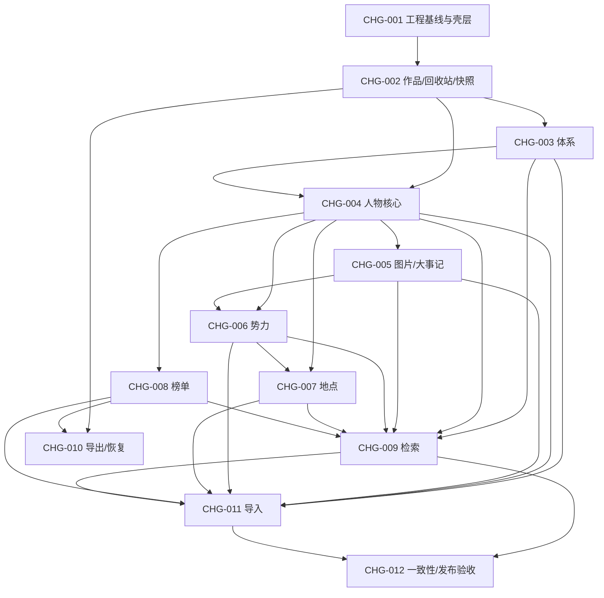

# P6 路线图 — MVP 垂直切片与 Spec 追踪

- 版本：v1.0（P6，2026-11-07）
- 状态：已确认（2026-11-07，见 §9）
- 上游基线：requirements v1.0、product-brief、user-stories、mvp-scope、architecture v1.2、data-model、api-contract、design-system v1.0、P5 审查结论
- Spec 目录：[project/specs](file:///d:/Project/novel-management/project/specs/README.md)
- 说明：所有变更为「计划」状态，不代表已实现。交付策略与确认结果见 §3、§9。

---

## 1. 前置一致性检查与裁决

P6 启动时按 [00-operating-manual.md](file:///d:/Project/novel-management/workflow/00-operating-manual.md) 做全量对照，发现 3 处冲突，已由人工裁决并同步上游：

| ID | 冲突内容 | 涉及文档 | 裁决 | 处理 |
|---|---|---|---|---|
| C-01 | 体系配置路由：architecture §5.4 `/system` vs PG-10/user-flow `/systems` | architecture、PG-10、user-flow | 采用 `/system`（架构契约权威） | 已同步 PG-10、user-flow；architecture 变更历史 v1.2 |
| C-02 | 作品名称上限：PG-00 1–100 vs data-model/API `/meta` 1–200；简介 2,000 vs 20,000 | PG-00、data-model、api-contract | 采用 200 / 20,000（数据与 API 契约权威） | 已同步 PG-00；本路线图与 Spec 按 1–200 |
| C-03 | architecture §10 追溯矩阵验收列整体错位（FR-09~12→AC-05、FR-21~26→AC-10 等） | architecture、requirements | 以 requirements AC 语义为准重建矩阵 | 已修正 architecture §10；P6 追踪矩阵见 §6 |

**非冲突但已记录的残留**：P5 的 V-02（检索 P95 基线）、V-03（axe 扫描）尚未执行，作为 CHG-009/CHG-012 的验收前置；`PG-11` 的 Markdown 单文件大小仍无独立上限，导入以 zip ≤6GB 与单图 ≤10MB 为硬约束，md 文件大小不单列验收。页面规格原标「P5b 待复审」，经 2026-11-07 人工确认已统一改为 `Approved`（仅元数据同步，内容未改，见 §9 Q-04）。

---

## 2. 规划原则

1. **垂直切片**：每个变更都产出可被用户走通的端到端价值，而非按后端层横切。
2. **先安全基座**：作品、回收站、快照、并发与引用规则先行，避免后续实体各自实现删除语义。
3. **引用驱动顺序**：人物 → 势力/地点/榜单 → 体系引用 → 检索 → 导入/导出。
4. **UI 不缺席**：每个变更必须包含对应页面、交互状态与设计系统任务；详见 §7。
5. **不强行拆分**：同一用户价值内聚在一个变更；仅当验收面独立或风险隔离需要时才拆。
6. **每个增量可回滚**：代码回滚 + 数据快照回退；破坏性操作前必须已有快照。

---

## 3. 变更总览与首批交付

| 变更 | 名称 | 关联 Spec | 依赖 | 复杂度 | 批次 |
|---|---|---|---|---|---|
| CHG-001 | 工程基线、应用壳层与设计系统基座 | SPEC-PLAT-001、SPEC-PLAT-002、SPEC-PLAT-004、SPEC-PLAT-005（部分） | — | L | 首批 |
| CHG-002 | 作品生命周期与回收站/快照基座 | SPEC-WORK-001~SPEC-WORK-004、SPEC-TRASH-001~SPEC-TRASH-004（作品）、SPEC-BACKUP-003、SPEC-PLAT-003 | CHG-001 | L | 首批 |
| CHG-003 | 体系类别与节点 | SPEC-SYS-001~SPEC-SYS-005 | CHG-002 | M | 首批 |
| CHG-004 | 人物档案核心 | SPEC-CHAR-001~SPEC-CHAR-005、SPEC-CHAR-008、SPEC-WORK-001（隔离收口） | CHG-002、CHG-003 | L | 首批 |
| CHG-005 | 人物图片与大事记 | SPEC-CHAR-006、SPEC-CHAR-007 | CHG-004 | M | 第二批 |
| CHG-006 | 势力树、首领与成员 | SPEC-FACTION-001~SPEC-FACTION-004 | CHG-004、CHG-005 | M | 第二批 |
| CHG-007 | 地点树与人物/势力关系 | SPEC-LOC-001~SPEC-LOC-003 | CHG-004、CHG-006 | M | 第二批 |
| CHG-008 | 榜单与席位 | SPEC-RANK-001~SPEC-RANK-004 | CHG-004 | M | 第二批 |
| CHG-009 | 快速搜索与条件检索 | SPEC-SEARCH-001~SPEC-SEARCH-005 | CHG-003~008 | L | 第三批 |
| CHG-010 | 导出、CLI 恢复与快照收口 | SPEC-BACKUP-001~SPEC-BACKUP-004 | CHG-002、CHG-008 | M | 第三批 |
| CHG-011 | 飞书《正文》迁移导入与校对 | SPEC-MIG-001~SPEC-MIG-005 | CHG-003~009 | L | 第三批 |
| CHG-012 | 关系一致性、异常状态与发布验收 | SPEC-PLAT-002~SPEC-PLAT-005（收口）、SPEC-TRASH-004（跨回收站）、跨域 AC | CHG-009、CHG-011 | M | 收口 |

**交付策略（2026-11-07 已确认）**：一次性按拓扑序推进 `CHG-001~012`，不在批次之间设置人工闸门。`CHG-001~004` 仍作为首个可用里程碑：完成后系统可启动、创建多作品、配置体系、维护人物档案并使用回收站恢复，可先进行真实试用；后续变更在其上连续叠加。「批次」列只表示建议节奏，不作为开工前置条件。

---

## 4. 依赖图（无环）

- 拓扑序：`001 → 002 → 003 → 004 → 005 → 006 → 007 → 008 → 009 → 010 → 011 → 012`。
- 无环校验：所有边均指向更高序号；不存在回边。`CHG-010` 可在 `CHG-009` 前并行启动，但验收依赖 `CHG-008`。
- 关键路径：001 → 002 → 003 → 004 → 005 → 006 → 007 → 009 → 011 → 012。

---

## 5. 变更详情

### CHG-001 工程基线、应用壳层与设计系统基座

- **目标**：`docker compose up -d` 可运行空系统，具备统一页面壳层、设计令牌与全局状态，作为后续所有切片的承载。
- **关联 Spec**：SPEC-PLAT-001（壳层/导航）、SPEC-PLAT-002（全局状态基座）、SPEC-PLAT-004（设计系统/可访问性基座）、SPEC-PLAT-005（部署/安全/性能基座）。
- **范围**：
  - 后端骨架：`cmd/server`、`cmd/cli`、`internal/{httpapi,service,domain,repository,model,search,cache,jobs,config,observability}`；`/health`、`/meta`、`/settings`；统一错误 DTO `code/message/details/request_id`。
  - 基础设施：docker compose（app/db/cache/redis 不发布端口）、迁移基线、静态资源托管、CSP 基线。
  - 前端骨架：Next.js App Router 静态导出、`app` 布局、`components/ui` 基线组件、设计令牌 CSS 变量、1280/1024 布局、404、无作品空状态。
  - 设计系统基线组件：Button、Input、FormField、Select、Dialog、Drawer、Toast、Badge、Skeleton、EmptyState、Table、Pagination、FilterBar、Tabs、Card、Progress。
- **非目标**：任何业务实体 CRUD、作品创建、导入/导出、检索、登录/权限/暗色主题。
- **模块/文件预期**：
  - `backend/cmd/server/main.go`、`backend/internal/httpapi/{router,health,meta,errors}.go`、`backend/internal/config`、`backend/migrations/0001_init.*`
  - `backend/Dockerfile`、`docker-compose.yml`、`.env.example`
  - `web/app/layout.tsx`、`web/app/(shell)/page.tsx`、`web/components/ui/*`、`web/styles/tokens.css`、`web/lib/api/client.ts`
- **UI/设计系统任务**：PG-00 顶栏/导航/路由框架；全局 loading/empty/error/404；设计令牌与 16 个基线组件；axe 基线；视觉回归基线截图。
- **DoD**：
  - `docker compose up -d` 三服务健康，`/health` 200，浏览器访问 `http://127.0.0.1:17860` 可见壳层。
  - `/meta` 返回 `limits`（name=200、description=20000、relation_note=500）与版本；`/settings` 返回只读版本/数据目录。
  - 无作品时为空状态引导；未知路由 404；1024 宽不横向溢出。
  - 16 个组件具备 default/hover/focus/disabled/loading/error 状态与键盘可达；axe 壳层无 serious/critical。
  - 文档：architecture 模块与目录结构无新增偏差；README 启动步骤可复现。
- **测试与验证**：
  - 单元：config 解析、错误映射、limits 常量。
  - 集成：`/health`、`/meta`、`/settings`、CSP 头、静态文件托管。
  - E2E：E2E-12（壳层部分）；axe 壳层扫描；人工按 README 从零启动。
- **依赖**：无。
- **复杂度**：L（跨前后端与容器，但无业务规则）。
- **风险**：Next 静态导出与 Go 托管路径不一致；CSP 阻断 Next 资源；容器内 pg_dump 不可用。
- **回滚**：代码回退到空仓库基线；无业务数据，删除卷即可；容器镜像回退上一 tag。

### CHG-002 作品生命周期与回收站/快照基座

- **目标**：用户可创建、切换、编辑、删除并恢复整本作品；建立统一软删除、撤销、恢复与破坏性操作前快照的公共基座。
- **关联 Spec**：SPEC-WORK-001~SPEC-WORK-004、SPEC-TRASH-001~SPEC-TRASH-004（作品范围）、SPEC-BACKUP-003（快照核心）、SPEC-PLAT-003（并发基座）。
- **范围**：
  - 作品 CRUD；创建时同事务写入内置「境界」类别（最小数据初始化，UI 配置留 CHG-003）。
  - `work_id` 上下文中间件与查询强制过滤；作品名称 `name_key` 全局唯一。
  - 通用软删除字段（`deleted_at/deleted_root_id/delete_batch_id`）、8 秒撤销令牌、回收站列表/筛选/定位、恢复与 `renames[]` 协议（先支持作品）。
  - 快照服务：删除作品前 `pg_dump` + media + checksums + manifest + meta，保留 3 份；失败阻止删除。
  - 作品切换器、删除确认、回收站页（作品类型）、设置页快照只读卡片。
- **非目标**：人物/势力/地点/榜单/体系的软删除注册（由各自变更接入）；导出 zip；CLI 恢复；导入。
- **模块/文件预期**：
  - `backend/internal/domain/{work,trash,namelock}.go`、`service/{work,trash,undo}.go`、`repository/works.go`、`snapshots/*`、`httpapi/{works,trash,undo}.go`
  - `backend/migrations/0002_works_trash_snapshots.*`
  - `web/features/works/*`、`web/features/trash/*`（作品类型）、`web/features/settings/SnapshotCard.tsx`、`web/hooks/use-current-work.ts`
- **UI/设计系统任务**：PG-00 作品切换器/新建 Dialog/删除确认；PG-12 回收站列表、撤销 Toast、恢复冲突 Dialog；PG-13 快照卡片；未保存切换确认；错误/空/加载态。
- **DoD**：
  - 创建两本作品并切换，数据上下文正确；同名（含大小写变体）拒绝；刷新保持当前作品。
  - 删除作品前快照必存在；删除后整本隐藏、8 秒撤销可用、恢复支持 `renames[]` 原子提交。
  - 快照保留最近 3 份；快照失败时删除被阻止且无数据变更。
  - 删除/恢复/撤销重复请求幂等；`If-Match` 缺失/过期返回明确错误。
  - UI：切换器、删除确认、回收站、快照卡片全部具备 loading/empty/error 状态。
- **测试与验证**：
  - 单元：名称规范化、`name_key`、删除根传播、撤销 TTL、快照保留策略。
  - 集成：作品 CRUD、跨作品隔离、软删除/恢复、快照生成与清理、并发 409。
  - E2E-01：创建/切换/编辑/删除/撤销/恢复；AC-01（作品级）、AC-13（作品）、AC-30（路径穿越基础拒绝）。
  - 人工：杀掉快照进程验证阻止删除；断网验证切换器错误态。
- **依赖**：CHG-001。
- **复杂度**：L（删除/恢复协议是后续全部实体的公共契约）。
- **风险**：`renames[]` 协议设计不当会导致后续实体返工；`pg_dump` 版本/权限；当前作品并发切换竞态。
- **回滚**：回退代码与 `0002` 迁移（或从删除前快照恢复）；作品数据在快照中可回退；UI 隐藏入口。

### CHG-003 体系类别与节点

- **目标**：用户可在 `/system` 维护内置境界与自定义类别、两级节点、排序与纪元，并看到引用计数；整组删除可回收。
- **关联 Spec**：SPEC-SYS-001~SPEC-SYS-005。
- **范围**：
  - 类别 CRUD、改名、启停、上限 10、类型不可变、内置境界保护；节点两级、同级唯一、排序、纪元。
  - 引用计数（人物引用）与删除阻断；类别整组软删除/恢复；`renames[]`。
  - `/system` 页面：类别侧栏 + 节点树 + 内联表单 + 启用开关 + 引用提示。
- **非目标**：人物表单动态渲染（CHG-004 接入）；检索同步（CHG-009）；导入解析类别（CHG-011）。
- **模块/文件预期**：`internal/{domain/system,service/system,repository/system,httpapi/system}.go`、`migrations/0003_system.*`、`web/features/system/*`。
- **UI/设计系统任务**：PG-10 类别列表、节点树、排序控件、停用开关、引用 Dialog、空/错误态；复用 Tree/Badge/Dialog/Select，新增 Tree 变体与排序按钮组。
- **DoD**：
  - 每作品含且仅含 1 个内置境界；不可删/停/改名；第 11 类拒绝。
  - 节点最多两级；同级重名拒绝；排序持久化；纪元可存空。
  - 被人物引用的类别/节点删除被阻止并列出引用；无引用整组删除进回收站并可整组恢复。
  - 改名后节点与引用展示同步；停用后人物表单不再出现（该 UI 在 CHG-004 验收）。
- **测试与验证**：单元（类别上限、两级、同级唯一、内置保护）；集成（引用计数、整组删除/恢复、`renames[]`）；E2E-06（配置部分）；AC-07（无人物引用部分）、AC-13（整组）、EX-16。
- **依赖**：CHG-002。
- **复杂度**：M。
- **风险**：类别与节点整组恢复的根 ID 传播；停用/删除语义混淆；内置境界初始化重复。
- **回滚**：回退 `0003` 迁移与前端入口；已有数据从快照恢复；不影响其他域。

### CHG-004 人物档案核心

- **目标**：用户可创建、浏览、筛选、编辑人物档案（含体系动态字段、别名/称号），并完成作品隔离与安全删除；这是首个完整业务价值切片。
- **关联 Spec**：SPEC-CHAR-001~SPEC-CHAR-005、SPEC-CHAR-008、SPEC-WORK-001（隔离收口）、SPEC-PLAT-003。
- **范围**：
  - 人物字段与校验、别名/称号、体系引用、势力引用占位（势力页在 CHG-006）、主图占位（图片在 CHG-005）。
  - `/characters` 列表（筛选/排序/分页/缩略图占位）、`/characters/:id` 详情（关系区骨架）、Drawer 新建、内联编辑。
  - 乐观锁 `version` + `If-Match`、未保存离开守卫；人物软删除、出向关系解除、入向引用检查框架。
- **非目标**：图片上传/缩略图（CHG-005）、大事记（CHG-005）、势力/地点/榜单关系（后续变更）、检索页（CHG-009）、导入、校对。
- **模块/文件预期**：
  - `internal/{domain/character,service/character,repository/characters,httpapi/characters}.go`
  - `migrations/0004_characters.*`
  - `web/features/characters/{list,detail,create-drawer,inline-edit}/*`、`web/components/ui/{Drawer,Table,FilterBar,Pagination,Skeleton,EmptyState}`
- **UI/设计系统任务**：PG-02 列表/筛选/排序/分页/Drawer/错误态；PG-03 详情/关系区骨架/内联编辑/未保存 Dialog/冲突提示；动态表单字段按类别生成；复用设计系统组件并补 FormField 错误态与 Table 空态。
- **DoD**：
  - 新建人物动态字段正确；主名称同作品唯一（英文大小写等价）；别名/称号可增删改。
  - 列表 1000 人物 P95 ≤500ms，筛选/排序/分页可用；详情首屏显示名称、别名、势力/境界占位、图片占位。
  - 内联编辑保存/取消/未保存离开/409 冲突全部可用；重复提交幂等。
  - 人物删除：入向首领/席位检查框架接入（当前无数据则通过），出向关系解除，8 秒撤销与回收站恢复可用。
  - 作品隔离：两本作品同名人物互不可见、不可互引。
- **测试与验证**：
  - 单元：字段校验、`name_key`、别名去重、动态类别启用、删除引用矩阵。
  - 集成：CRUD、跨作品隔离、`If-Match` 409、软删除/撤销/恢复。
  - E2E-02（无图/无大事记部分）、AC-01、AC-03、AC-16、AC-17、AC-24。
  - 性能：1000 人物种子数据列表 P95。
- **依赖**：CHG-002、CHG-003。
- **复杂度**：L。
- **风险**：动态字段与类别停用/改名耦合；乐观锁前端实现不一致；列表性能与缩略图占位。
- **回滚**：回退 `0004` 与前端入口；人物数据可从删除前快照或导入前快照恢复；关闭导航入口。

### CHG-005 人物图片与大事记

- **目标**：人物可维护 1 张主图与按序大事记，缩略图懒加载不阻塞文字，形成完整人物档案。
- **关联 Spec**：SPEC-CHAR-006、SPEC-CHAR-007。
- **范围**：图片上传/替换/移除、MIME+魔数校验、重编码、缩略图、懒加载；大事记 CRUD、2,000 字上限、轻撤销。
- **非目标**：势力/地点图片、多图相册、裁剪、大事记聚合时间线、导入图片（CHG-011 复用）。
- **模块/文件预期**：`internal/{domain/media,service/media,repository/media,httpapi/media}.go`、`internal/httpapi/chronicles.go`、`migrations/0005_media_chronicles.*`、`web/features/characters/{image-uploader,chronicle-list}/*`。
- **UI/设计系统任务**：PG-03 图片上传区（预览/错误/移除）、缩略图懒加载、大事记列表/编辑/删除 Toast；新增 ImageUploader 与 ChronicleList，复用 Dialog/Toast/EmptyState。
- **DoD**：≤10MB jpg/png/webp 可上传并显示；非法格式/超大拒绝且保留表单；列表懒加载不阻塞文字；大事记增删改、2,000 字校验、8 秒撤销。
- **测试与验证**：单元（MIME/魔数/大小/缩略图尺寸、2,000 字）；集成（图片存储/引用计数、大事记 CRUD）；E2E-02（图片/大事记）、AC-33、AC-17；慢网人工验证懒加载。
- **依赖**：CHG-004。
- **复杂度**：M。
- **风险**：图片重编码兼容性、缩略图缓存、删除时的文件悬空；大事记与实体删除的根传播。
- **回滚**：回退 `0005` 与上传入口；关闭图片/大事记 UI；已上传文件保留但不可见。

### CHG-006 势力树、首领与成员

- **目标**：用户可用单棵树维护势力、内联新建、设置首领、查看直属/含下级成员，并安全移动与删除。
- **关联 Spec**：SPEC-FACTION-001~SPEC-FACTION-004。
- **范围**：势力树、名称唯一、内联新建/编辑、搜索定位、首领引用、成员推导（直属/含下级）、移动环校验、删除引用矩阵、整组回收站（含势力大事记，复用 SPEC-CHAR-007 协议）。
- **非目标**：多棵树、职位/副首领、势力图片、势力引用体系、批量成员操作。
- **模块/文件预期**：`internal/{domain/faction,service/faction,repository/factions,httpapi/factions}.go`、`migrations/0006_factions.*`、`web/features/factions/*`。
- **UI/设计系统任务**：PG-04 树/内联表单/搜索定位/空态；PG-05 详情/首领选择/成员切换/移动 Dialog/引用 Dialog；复用 Tree/Dialog/Badge，新增成员列表与「含下级」SegmentedControl。
- **DoD**：三级势力正确挂载；首领/成员推导正确；移动自身/后代被阻止；删除按矩阵阻止或允许；恢复父级不存在时阻止；人物改名/换势力后双向同步。
- **测试与验证**：单元（树、环检测、引用矩阵、成员去重）；集成（树 CRUD、移动、删除/恢复）；E2E-03、AC-04、AC-09、AC-14、EX-18。
- **依赖**：CHG-004、CHG-005（大事记基础）。
- **复杂度**：M。
- **风险**：递归成员查询性能、环检测、父级恢复顺序。
- **回滚**：回退 `0006` 与导航；数据从快照恢复；其他域不受影响。

### CHG-007 地点树与人物/势力关系

- **目标**：用户可维护地点层级与类型，并双向维护人物-地点、地点-势力关系及备注。
- **关联 Spec**：SPEC-LOC-001~SPEC-LOC-003。
- **范围**：地点树、类型建议、筛选/待校对视图、人物-地点关系、地点-势力关系、详情双向跳转、删除三类入向阻断。
- **非目标**：地点图片/大事记、地图/坐标、多棵树、级联删除。
- **模块/文件预期**：`internal/{domain/location,service/location,repository/locations,httpapi/locations}.go`、`migrations/0007_locations.*`、`web/features/locations/*`。
- **UI/设计系统任务**：PG-06 树/类型输入建议/待校对视口；PG-07 详情/关系编辑/双向链接/删除引用 Dialog；复用 Tree/Dialog/Table，新增关系备注行内编辑。
- **DoD**：三级地点正确；类型建议可用；人物/势力两侧关系与备注一致；删除地点时下级/人物关系/势力关系全部阻止；恢复父级缺失时阻止。
- **测试与验证**：单元（树、类型、关系备注、删除矩阵）；集成（关系 CRUD、双向更新）；E2E-04、AC-05、AC-09、AC-14。
- **依赖**：CHG-004、CHG-006（势力关系）。
- **复杂度**：M。
- **风险**：双向关系更新事务、删除阻断清单过长、树搜索定位。
- **回滚**：回退 `0007` 与导航；快照恢复；不影响人物/势力数据。

### CHG-008 榜单与席位

- **目标**：用户可创建榜单、维护 1..N 席位、指派/移动/交换/移出人物，并扩容/缩容与安全删除恢复。
- **关联 Spec**：SPEC-RANK-001~SPEC-RANK-004。
- **范围**：榜单 CRUD、名称唯一、席位表（50/页、跳席）、指派/移动/交换/移出、备注、人物详情名次、扩容/缩容校验、删除/恢复人物存在校验。
- **非目标**：自动排名、并列建模、批量导入席位（CHG-011 覆盖）、拖拽排序。
- **模块/文件预期**：`internal/{domain/ranking,service/ranking,repository/rankings,httpapi/rankings}.go`、`migrations/0008_rankings.*`、`web/features/rankings/*`。
- **UI/设计系统任务**：PG-08 列表/新建/空态；PG-09 席位表格/空席/指派 Dialog/移动交换/跳席/扩容缩容/删除恢复；新增 SeatGrid 与跳席控件，复用 Pagination/Dialog/Table。
- **DoD**：100 席榜单每页 50；空席可见；移动/交换/重复指派规则正确；缩容仅尾部空席；删除/恢复按人物存在校验；人物详情名次双向同步。
- **测试与验证**：单元（席位不变量、重复指派、缩容、恢复校验）；集成（席位事务、分页、删除/恢复）；E2E-05、AC-06、AC-09、AC-14、EX-17/EX-19/EX-20。
- **依赖**：CHG-004。
- **复杂度**：M。
- **风险**：交换事务与唯一约束、50 席分页与跳席、恢复时人物缺失。
- **回滚**：回退 `0008` 与导航；快照恢复；人物/势力不受影响。

### CHG-009 快速搜索与条件检索

- **目标**：用户可从任意页面快速搜索当前作品五类实体，别名/称号可命中，结果分组、排序、分页并可跳转。
- **关联 Spec**：SPEC-SEARCH-001~SPEC-SEARCH-005。
- **范围**：`search_documents` 维护、GIN/trgm 索引、快速搜索、条件检索、分组/排序/分页/摘要/高亮、空/无结果/错误、作品隔离与回收站排除、性能基线。
- **非目标**：拼音/同义词/语义搜索、跨作品搜索、大事记检索、保存检索条件。
- **模块/文件预期**：`internal/{search,service/search,httpapi/search}.go`、`migrations/0009_search.*`、`web/features/search/*`、各域写入后的文档同步钩子。
- **UI/设计系统任务**：PG-01 搜索框/防抖/条件栏/分组结果/高亮/分页/空查询/无结果/错误；复用 FilterBar/Badge/Pagination，新增 ResultGroup 与高亮文本。
- **DoD**：五类实体可搜；别名/称号命中；多词 AND；英文大小写不敏感；大事记不命中；回收站与其他作品不出现；每组 20 条、稳定游标；P95 ≤150ms。
- **测试与验证**：单元（分词、排序权重、摘要）；集成（索引同步、隔离、删除/恢复）；E2E-07、E2E-13（性能）、AC-08、AC-23；1000 人物压测。
- **依赖**：CHG-003~CHG-008。
- **复杂度**：L。
- **风险**：中文短词检索质量、索引漂移、分组分页游标、性能基线。
- **回滚**：关闭导航搜索入口，回退 `0009`；实体数据不变；可降级为按名称 SQL 查询。

### CHG-010 导出、CLI 恢复与快照收口

- **目标**：用户可全量导出（可选含回收站），并在空环境用 CLI 恢复；快照可查看与回滚。
- **关联 Spec**：SPEC-BACKUP-001~SPEC-BACKUP-004。
- **范围**：导出 zip 五件套 + 可选 `trash/`；后台任务与下载；CLI `restore` / `restore-snapshot`；manifest/checksum/schema 校验；恢复前快照；设置页完整展示与空环境演练。
- **非目标**：增量导出、云备份、GUI 恢复按钮、定时快照、超过 3 份保留。
- **模块/文件预期**：`internal/{exports,service/export,httpapi/exports}.go`、`snapshots/*`、`cmd/cli/{restore,restore_snapshot,migrate,reindex,doctor}.go`、`migrations/0010_exports.*`、`web/features/settings/*`。
- **UI/设计系统任务**：PG-13 导出开关/进度/下载/失败重试、快照列表、恢复命令复制、空态；复用 Toast/Progress/Card/Table。
- **DoD**：导出含五件套与正确计数；含/不含回收站开关生效；CLI 空环境恢复成功；schema 不兼容拒绝；恢复前快照存在；最近 3 份保留。
- **测试与验证**：集成（导出内容/checksum、恢复、快照清理）；E2E-10；AC-12、AC-22；人工空容器演练。
- **依赖**：CHG-002、CHG-008（全实体导出验收）。
- **复杂度**：M。
- **风险**：pg_dump 与运行中写入、zip 大文件流式处理、恢复后检索重建。
- **回滚**：回退导出/CLI 代码；快照文件保留；恢复操作以恢复前快照回退。

### CHG-011 飞书《正文》迁移导入与校对

- **目标**：用户上传飞书《正文》模板 Markdown 与图片 zip，完成解析、校验、预览、原子导入、图片匹配、报告与待校对。
- **关联 Spec**：SPEC-MIG-001~SPEC-MIG-005。
- **范围**：上传/6GB/磁盘预检、模板解析、体系类别初始化、校验与错误清单、预览与确认、快照、原子提交、图片匹配、报告、校对（逐条/批量）、五项迁移验收（含用户签收）；飞书仅一次性迁移，不做双向同步。
- **非目标**：导入《设定集》、手工字段映射、增量/重复导入去重、自动校对。
- **模块/文件预期**：`internal/{imports,service/import,httpapi/imports,reviews}.go`、`migrations/0011_imports.*`、`web/features/imports/*`、各实体 `review` 字段接入。
- **UI/设计系统任务**：PG-11 上传/进度/校验错误表/预览/二次确认/报告下载/待校对跳转；复用 Table/Dialog/Progress/Toast，新增 Stepper 与错误清单表。
- **DoD**：合法上传导入八类实体与关系；错误禁止确认；原子失败回滚；图片错误阻断；报告完整；pending 徽标与批量确认；200/100/100/20/500 样本五项验收通过；用户按 AC-31 签收。
- **测试与验证**：夹具驱动集成（合法/缺字段/重复/坏引用/缺图/超大/坏 zip）；E2E-09；AC-10、AC-11、AC-18~AC-21、AC-25、AC-31；导入后检索一致性检查。
- **依赖**：CHG-003~CHG-009。
- **复杂度**：L。
- **风险**：模板歧义、6GB 流式内存、120 分钟任务、图片路径穿越、导入与快照/事务边界。
- **回滚**：导入前快照回退；删除导入批次（软删）；关闭导入入口；不影响既有作品。

### CHG-012 关系一致性、异常状态与发布验收

- **目标**：跨页关系与全局状态收口，完成首屏/可访问性/安全/跨回收站引用验收，达到可发布状态。
- **关联 Spec**：SPEC-PLAT-002~SPEC-PLAT-005（收口）、SPEC-TRASH-004（跨回收站）、SPEC-CHAR-004 / SPEC-FACTION-003 / SPEC-LOC-002 / SPEC-SEARCH-003（关系链接验收，行为在前序变更实现）。
- **范围**：
  - 全站空/加载/错误/网络/长任务状态审计；409/428 统一；未保存守卫覆盖全部表单。
  - 关系双向跳转与死链/回收站引用标注全量回归；跨回收站引用阻断与定位。
  - axe 全页扫描、键盘导航、对比度、CSP/上传/zip 安全复测、1000 人物首屏 ≤2s、列表/检索 P95。
- **非目标**：新增业务功能、新页面、性能优化超出基线、公网访问/HTTPS/登录。
- **模块/文件预期**：`web/components/ui/*`（状态与可访问性修正）、`web/app` 路由与守卫、`backend/internal/httpapi/errors.go`、`backend/internal/{service,media,imports}` 安全修正；测试与种子脚本。
- **UI/设计系统任务**：13 页状态矩阵审计与修正；设计系统状态补全（focus/disabled/error）；axe/键盘/对比度修复；视觉回归全量基线。
- **DoD**：
  - E2E-08/12/14/15 全绿；所有主流程页面有 loading/empty/error；无堆栈/路径泄露。
  - axe 全页无 serious/critical；键盘可完成新建/编辑/删除/恢复主流程。
  - AC-32 首屏 ≤2s、AC-23/24 性能达标、AC-29/30 安全通过。
  - 跨回收站引用：在线实体删除被阻止；回收站被引用实体不可永久删除；定位可用。
  - 发布清单：备份/恢复演练、快照可用、迁移可回滚、README 可复现。
- **测试与验证**：E2E-08/12/14/15；axe 全页；k6/Playwright 性能；CSP 与恶意上传/zip 安全用例；1000 人物种子首屏；人工发布检查单。
- **依赖**：CHG-009、CHG-011。
- **复杂度**：M（以验证与修复为主）。
- **风险**：跨页状态遗漏、性能回退、回收站引用死角、最后阶段集中修复范围蔓延。
- **回滚**：按变更粒度回退修复提交；数据无结构变更；发布镜像回退上一 tag。

---

## 6. 需求 → User Story → Page/API/Data → Spec → Change → Acceptance

### 6.1 功能需求

| Requirement | User Story | Page Spec / API / Data | Spec | Change | Acceptance |
|---|---|---|---|---|---|
| FR-01~03 作品 | US-001 | PG-00/PG-13；`/works`、`/meta`；`works`、`system_categories` | SPEC-WORK-001~SPEC-WORK-004 | CHG-002 | AC-01、AC-13、AC-17 |
| FR-04~08 人物 | US-002 | PG-02/PG-03；`/characters`、`/media`、`/chronicles`、`review`；`characters`、`character_names`、`media_assets`、`chronicles` | SPEC-CHAR-001~SPEC-CHAR-008 | CHG-004、CHG-005 | AC-02、AC-03、AC-14、AC-16、AC-17、AC-33 |
| FR-09~12 势力 | US-003 | PG-04/PG-05；`/factions`；`factions` | SPEC-FACTION-001~SPEC-FACTION-004 | CHG-006 | AC-04、AC-09、AC-14、EX-18 |
| FR-13~16 地点 | US-004 | PG-06/PG-07；`/locations`；`locations`、`character_locations`、`location_factions` | SPEC-LOC-001~SPEC-LOC-003 | CHG-007 | AC-05、AC-09、AC-14 |
| FR-17~20 榜单 | US-005 | PG-08/PG-09；`/rankings`；`rankings`、`ranking_seats` | SPEC-RANK-001~SPEC-RANK-004 | CHG-008 | AC-06、AC-09、AC-13、AC-14 |
| FR-21~26 体系 | US-006 | PG-10；`/system-categories`、`/system-nodes`；`system_categories`、`system_nodes`、`character_system_refs` | SPEC-SYS-001~SPEC-SYS-005 | CHG-003 | AC-07、AC-09、AC-13、AC-14 |
| FR-27~33 检索 | US-007 | PG-01；`/search`；`search_documents` | SPEC-SEARCH-001~SPEC-SEARCH-005 | CHG-009 | AC-08、AC-23 |
| FR-34~38 一致性/校对 | US-008 | PG-03/05/07/09/10；各详情端点、`/reviews`；关系表 | SPEC-CHAR-004、SPEC-FACTION-003、SPEC-LOC-002、SPEC-RANK-002、SPEC-SYS-004、SPEC-SEARCH-003 | CHG-004~CHG-009、CHG-012 | AC-09、AC-14、AC-21 |
| FR-39~46 导入 | US-009 | PG-11；`/imports`；`import_runs` + 全实体 | SPEC-MIG-001~SPEC-MIG-005 | CHG-011 | AC-10、AC-11、AC-18~AC-21、AC-25、AC-31 |
| FR-47~51 完整性 | 跨 US | PG-02/03/05/07/09/10；各写端点；约束/索引 | SPEC-PLAT-005 + 各域 Spec | CHG-001、CHG-004、CHG-012 | AC-11、AC-14、AC-17 |
| FR-52~56 导出/恢复 | US-010 | PG-13；`/exports`、`/snapshots`；`export_runs`、`snapshots` | SPEC-BACKUP-001~SPEC-BACKUP-004 | CHG-010（CHG-002 快照基座） | AC-12、AC-22 |
| FR-57~63 回收站 | US-011 | PG-12；`/trash`、`undo`、`restore`；`deleted_*` | SPEC-TRASH-001~SPEC-TRASH-004 + SPEC-WORK-003、SPEC-WORK-004 | CHG-002、各域变更、CHG-012 | AC-13、AC-14、AC-15 |
| FR-64~69 视觉/体验 | US-012 | PG-00~PG-13；设计系统 v1.0 | SPEC-PLAT-001、SPEC-PLAT-002、SPEC-PLAT-004 | CHG-001、CHG-012 | AC-15、AC-27、AC-28 |

### 6.2 异常与质量需求

| Requirement | Spec | Change | Acceptance / 验证 |
|---|---|---|---|
| EX-01~EX-04 基础状态 | SPEC-PLAT-002、SPEC-PLAT-003 | CHG-001、CHG-012 | 各页 loading/empty/error、幂等用例 |
| EX-05~EX-06 网络/超时 | SPEC-PLAT-002 | CHG-001、CHG-012 | 断网、超时、重试 E2E-12 |
| EX-07~EX-08 并发/未保存 | SPEC-PLAT-003 | CHG-002、CHG-004、CHG-012 | 409/428、未保存守卫 E2E-12；AC-16 |
| EX-09~EX-21 域内异常 | 对应域 Spec | CHG-003~CHG-011 | 各 Spec 验收场景；E2E-03/04/05/06/09/11 |
| EX-22~EX-23 上传/快照 | SPEC-MIG-001、SPEC-BACKUP-003、SPEC-CHAR-006 | CHG-005、CHG-010、CHG-011 | 超大/坏文件/快照失败用例 |
| EX-26~EX-27 死链/404 | SPEC-PLAT-001、SPEC-PLAT-002 | CHG-001、CHG-012 | E2E-08/12 |
| NFR 性能 | SPEC-PLAT-005、SPEC-SEARCH-004、SPEC-SEARCH-005 | CHG-001、CHG-009、CHG-012 | AC-23、AC-24、AC-32、AC-33 |
| NFR 安全 | SPEC-PLAT-005 | CHG-001、CHG-012 | AC-29、AC-30、CSP/上传/zip 用例 |
| V-01~V-05 验证项 | 各域 Spec | CHG-001~CHG-012 | 见 §8 每增量验证 |

### 6.3 Spec → Change 索引（全量）

| 域 | Spec ID | 变更 |
|---|---|---|
| works | SPEC-WORK-001、SPEC-WORK-002、SPEC-WORK-003、SPEC-WORK-004 | CHG-002；SPEC-WORK-001 隔离收口于 CHG-004 |
| characters | SPEC-CHAR-001、SPEC-CHAR-002、SPEC-CHAR-003、SPEC-CHAR-004、SPEC-CHAR-005、SPEC-CHAR-006、SPEC-CHAR-007、SPEC-CHAR-008 | CHG-004（001~005、008）；CHG-005（006、007）；关系验收 CHG-012 |
| factions | SPEC-FACTION-001、SPEC-FACTION-002、SPEC-FACTION-003、SPEC-FACTION-004 | CHG-006；SPEC-FACTION-003 跨页验收 CHG-012 |
| locations | SPEC-LOC-001、SPEC-LOC-002、SPEC-LOC-003 | CHG-007；SPEC-LOC-002 跨页验收 CHG-012 |
| rankings | SPEC-RANK-001、SPEC-RANK-002、SPEC-RANK-003、SPEC-RANK-004 | CHG-008 |
| systems | SPEC-SYS-001、SPEC-SYS-002、SPEC-SYS-003、SPEC-SYS-004、SPEC-SYS-005 | CHG-003；动态字段接入 CHG-004 |
| search | SPEC-SEARCH-001、SPEC-SEARCH-002、SPEC-SEARCH-003、SPEC-SEARCH-004、SPEC-SEARCH-005 | CHG-009；结果跳转验收 CHG-012 |
| migration | SPEC-MIG-001、SPEC-MIG-002、SPEC-MIG-003、SPEC-MIG-004、SPEC-MIG-005 | CHG-011 |
| backup | SPEC-BACKUP-001、SPEC-BACKUP-002、SPEC-BACKUP-003、SPEC-BACKUP-004 | CHG-010；快照基座随 CHG-002，设置页只读随 CHG-001 |
| trash | SPEC-TRASH-001、SPEC-TRASH-002、SPEC-TRASH-003、SPEC-TRASH-004 | CHG-002（作品/基座）；实体类型注册随 CHG-003~CHG-011；跨回收站验收 CHG-012 |
| platform | SPEC-PLAT-001、SPEC-PLAT-002、SPEC-PLAT-003、SPEC-PLAT-004、SPEC-PLAT-005 | CHG-001（基座）；CHG-012（收口验收） |

---

## 7. UI 页面、交互状态与设计系统覆盖

| 页面 | 覆盖变更 | 交互状态要求 | 设计系统任务 |
|---|---|---|---|
| PG-00 全局壳层 | CHG-001、CHG-002、CHG-004、CHG-012 | 作品切换/未保存/加载/错误/404/无作品 | 顶栏、导航、WorkSwitcher、Dialog、Toast、Skeleton |
| PG-00 检索框 | CHG-009 | 防抖/空/错误/跳转 | Input、ResultGroup、高亮 |
| PG-01 检索页 | CHG-009、CHG-012 | 空查询/无结果/错误/分组/分页 | FilterBar、Pagination、Badge、EmptyState |
| PG-02 人物列表 | CHG-004 | 加载/空/筛选无结果/错误/懒加载 | Table、FilterBar、Pagination、Skeleton |
| PG-03 人物详情 | CHG-004、CHG-005、CHG-006/007/008（关系链接）、CHG-012 | 编辑/未保存/409/图片错误/死链 | Drawer、FormField、ImageUploader、ChronicleList、Dialog |
| PG-04 势力树 | CHG-006 | 加载/空/搜索定位/内联错误 | Tree、InlineForm、SearchBox、EmptyState |
| PG-05 势力详情 | CHG-006、CHG-012 | 成员口径/移动/删除阻断/恢复冲突 | SegmentedControl、Dialog、Badge、Table |
| PG-06 地点树 | CHG-007 | 加载/空/类型建议/待校对筛选 | Tree、Combobox、Badge |
| PG-07 地点详情 | CHG-007、CHG-012 | 双向关系/备注/删除阻断/死链 | RelationList、Dialog、Table |
| PG-08 榜单列表 | CHG-008 | 空/加载/错误/删除恢复 | Table、Dialog、EmptyState |
| PG-09 榜单详情 | CHG-008 | 50 席分页/跳席/空席/冲突 | SeatGrid、Pagination、Dialog、Badge |
| PG-10 体系配置 | CHG-003、CHG-004、CHG-012 | 类别上限/内置保护/停用/引用/整组恢复 | Tree、Badge、Dialog、Switch、SortButtons |
| PG-11 导入向导 | CHG-011 | 上传/进度/校验错误/预览/确认/报告 | Stepper、Table、Progress、Dialog、Toast |
| PG-12 回收站 | CHG-002、CHG-004~CHG-011（类型注册）、CHG-012 | 类型筛选/定位高亮/冲突改名/永久删除/清空 | Table、FilterBar、Dialog、Toast、Badge |
| PG-13 设置/备份 | CHG-001（只读）、CHG-002（快照卡）、CHG-010（导出/恢复） | 进度/下载/失败重试/空快照/复制命令 | Card、Progress、Table、Toast |

**覆盖结论**：13 个主页面 + 全局壳层均有对应变更；每个变更的 DoD 明确要求 loading/empty/error/未保存/并发状态与设计系统组件复用，未出现「只拆后端」的变更。

---

## 8. 每个增量的验证方式

| 变更 | 单元 | 集成 | E2E / 页面 | 人工 / 非功能 |
|---|---|---|---|---|
| CHG-001 | config、错误映射、limits | health/meta/settings/CSP/静态托管 | E2E-12（壳层）、axe 壳层 | 从零启动、1024 布局 |
| CHG-002 | name_key、删除根、撤销 TTL、快照保留 | 作品 CRUD、隔离、删除/恢复、快照、409 | E2E-01、AC-01/13 | 快照失败阻止删除、断网切换器 |
| CHG-003 | 类别上限、两级、同级唯一、内置保护 | 引用计数、整组删除/恢复、`renames[]` | E2E-06（配置）、AC-07/13 | 第 11 类、恢复冲突人工 |
| CHG-004 | 字段校验、别名去重、动态字段、删除矩阵 | 人物 CRUD、跨作品隔离、409、撤销/恢复 | E2E-02（部分）、AC-03/16/17/24 | 1000 人物列表性能 |
| CHG-005 | MIME/魔数/大小/2,000 字 | 图片存储/引用计数、大事记 CRUD | E2E-02（图片/大事记）、AC-33 | 慢网懒加载、非法文件 |
| CHG-006 | 树/环/引用矩阵/成员去重 | 势力 CRUD、移动、删除/恢复 | E2E-03、AC-04/09/14 | 环移动、父级恢复 |
| CHG-007 | 树/类型/关系备注/删除矩阵 | 关系 CRUD、双向更新 | E2E-04、AC-05/09/14 | 三类阻断清单 |
| CHG-008 | 席位不变量、重复指派、缩容、恢复 | 席位事务、分页、删除/恢复 | E2E-05、AC-06/09/14 | 50 席分页与跳席 |
| CHG-009 | 分词/权重/摘要 | 索引同步、隔离、删除/恢复 | E2E-07/E2E-13、AC-08/23 | 1000 人物 P95 压测、中文短词 |
| CHG-010 | manifest/checksum 解析 | 导出内容、CLI 恢复、快照清理 | E2E-10、AC-12/22 | 空容器恢复演练 |
| CHG-011 | 模板解析、校验、类别协议 | 夹具导入（合法/错误/缺图/超大）、原子回滚 | E2E-09、AC-10/11/18~21/25 | 6GB 流式、120 分钟、恶意 zip |
| CHG-012 | —（回归为主） | 全接口错误映射/安全 | E2E-08/12/14/15、AC-09/15/27~30/32 | axe 全页、键盘、首屏 2s、发布检查单 |

---

## 9. 人工确认结果（2026-11-07）

| 编号 | 事项 | 决定 |
|---|---|---|
| Q-01 | P6 交付物与交付节奏 | 批准 51 条 Spec 与 12 个变更；一次性按拓扑序推进 `CHG-001~012`，不设批次闸门。`CHG-001~004` 作为首个可用里程碑，可用于第一次真实试用。 |
| Q-02 | CHG-010 并行 | 允许与 CHG-009 并行开发；验收仍依赖 CHG-008 完成。 |
| Q-03 | P5 遗留 V-02/V-03 | 按路线图执行：V-02 检索 P95 基线放在 CHG-009，V-03 axe 全页扫描放在 CHG-012。 |
| Q-04 | 页面规格状态 | PG-00~PG-13 状态由「P5b 待复审」统一改为 `Approved`；仅元数据同步，页面内容未改。 |

**后续**：按 `CHG-001 → CHG-002 → … → CHG-012` 拓扑序进入 P7；每个变更完成时按 §8 验证，并将对应 Spec 状态由 `planned` 更新为 `implemented`（验收通过后 `verified`）。
